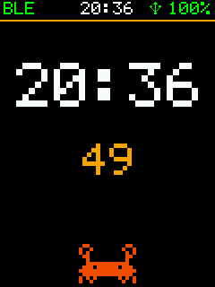
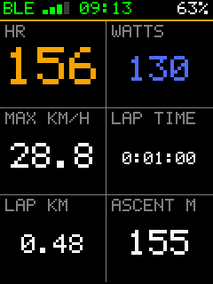

# bryton-rustfw

An open, from-scratch firmware in safe Rust for the **Bryton Rider S510** bike computer. It replaces Bryton's OS
entirely. Not affiliated with Bryton.

| | | | |
|:-:|:-:|:-:|:-:|
|  |  |  |  |
| Main screen (unit) | Ride page, zone graph (sim) | HR / power in zone colours (sim) | Map with the track (sim) |
|  |  |  | |
| Menu (unit) | Sensors and built-in readings (unit) | GPS (sim) | |

*"unit": a screenshot of the bike computer over USB (`./dev.py shot`, rendered by the firmware from what it drew);
"sim": the same firmware code drawing in the host simulator.*

**Status (2026-10-23):** runs installed on the unit. Ride pages, menus, ANT+ sensors (heart rate tried), GPS with
fast aided starts, a track map, battery, backlight with an automatic mode, beeps, and a USB dev link. Rides are not
saved yet: the FIT writer is ready, the eMMC driver reads but does not write yet.

| Read | For |
|---|---|
| [docs/features.md](docs/features.md) | what it does, screen by screen |
| [docs/install.md](docs/install.md) | build, the ANT+ key, install, and the way back to stock |
| [docs/status.md](docs/status.md) | what is not yet seen on the unit, next steps |
| [docs/journal.md](docs/journal.md) | what was found on the unit, dated |
| [docs/boot.md](docs/boot.md) | how it starts, from the bootloader's hand-off |
| [BOARD.md](BOARD.md) | the hardware: pin map, timing diagrams, every chip, with evidence |
| [AGENTS.md](AGENTS.md) | how to work on it: rules, tests, the dev loop |

It replaces the OS: **no rides are saved yet, and no updates come from this firmware.** The way back is the
bootloader's recovery mode, which this firmware cannot touch ([docs/install.md](docs/install.md)).
