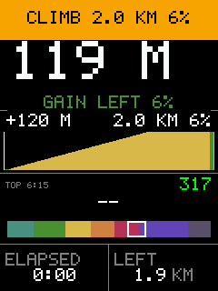
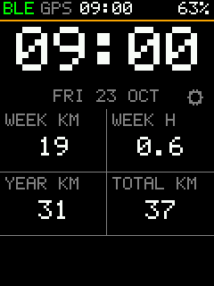
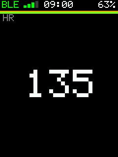
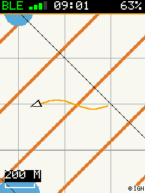
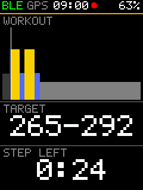
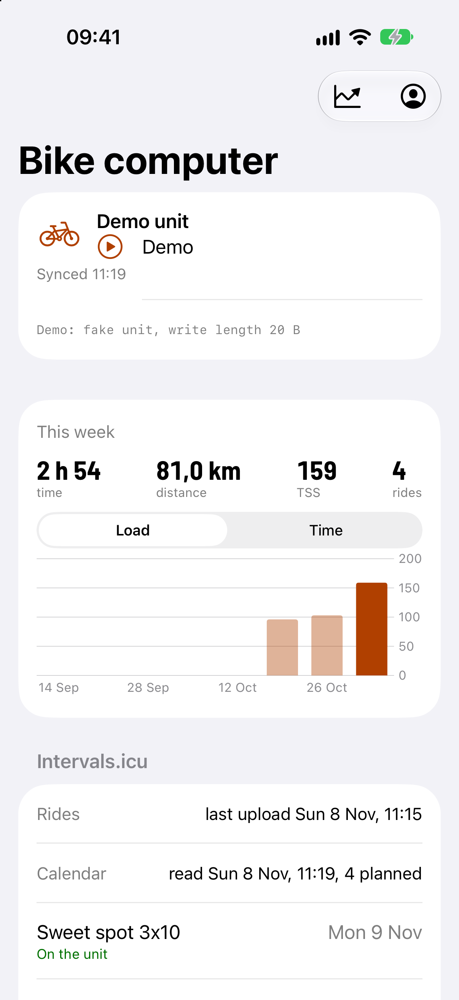

# bryton-rustfw 🦀

An open, from-scratch firmware in safe Rust for the **Bryton Rider S510** bike computer. It replaces Bryton's OS
entirely. Not affiliated with Bryton.

## Climbs ahead and the climb coach

On the road ahead, even without a course, the bike computer finds the climbs (Garmin ClimbPro's definition, on
stock's own routing map), says the next one, and when it starts opens the **CLIMB page** once:
- the climb's profile, coloured by grade, the part done dark and the rider's place in white, as on the workout page;
- its gain, length and average grade written on the graph;
- above, the climb's title and the gain left; below, the **climb coach**: the power to hold for this section (its gauge has the time to the top),
  from CP and W' (the time to the top, the target and a gauge), so the climb is ridden at the pace that gets to the top
  soonest, then the time on the climb and the distance left. A live segment uses the same page (its name and the delta
  against your best), so you can pace against both the best time and the ideal power.

With a course followed, the same page uses the course's climbs. (Picture: the simulator on a made-up road.)

 

| | | | |
|:-:|:-:|:-:|:-:|
|  |  |  |  |
| Overview: the date, today's planned workout with its profile, four fields, notices (sim) | A zone as an 8 px bar on the box's top edge (sim) | The map over IGN pack tiles, "(c) IGN" in the corner (sim, synthetic tiles, not a map) | The workout graph: steps by target and zone, the rider's place (sim) |

More screens, grouped by menu: [the gallery](docs/gallery.md).

## The phone app

An iPhone app (Swift over a Rust core) lists the rides on the unit and downloads them over Bluetooth, to save or share.
Details, build and what the unit showed on a phone: [docs/app.md](docs/app.md). (Picture: the simulator in demo mode.)

 

*"unit": a screenshot of the bike computer over USB (`./dev.py shot`, rendered by the firmware from what it drew);
"sim": the same firmware code drawing in the host simulator.*

## Status (2026-11-07)

Runs on the unit: installed, and newer builds from RAM. What is on the unit's list still: [docs/status.md](docs/status.md).

- **Riding:** an overview and ride pages in several layouts, a page editor, graphs, touch and keys, menus, a PIXEL or
  SMOOTH font, colour themes (DARK, OUTDOOR, LIGHT, or a theme file), an MTB profile, auto power-off after 5 min idle.
- **Sensors and training:** ANT+ sensors, a power meter's calibration, a smart trainer (ERG, SIM, an FTP ramp test,
  the ERG target corrected by the power meter), derived power metrics (NP, TSS, W' balance...), heart rate
  variability (DFA a1, thresholds from recent rides) with the beats recorded raw, the workouts stock's app synced.
- **Navigation:** GPS with fast aided starts, a track map with a basemap (IGN Plan v2 packs, else stock's cached
  tiles), courses with climbs, a climb pacer, the climbs on the road ahead without a course, a CLIMB page that opens at
  a climb's start.
- **Rides:** saved to `\Activities` as stock does (seen on the unit), in two copies, and they survive a reset or a power
  cut; they need an `EMMC_WRITE=1` build (docs/install.md). Sync to Intervals.icu from the computer (docs/sync.md). The
  storage is shared with Bryton's firmware, so the two can be swapped.
- **Phone:** the phone as a Bluetooth accessory (notifications, media), and since 2026-11-07 the iPhone app: on the
  owner's iPhone it shows the unit and its battery, lists the rides (date, time, distance, load) and downloads them, byte for byte identical to the
  USB copy, with weekly totals like Intervals.icu's. The fast link (larger packets) works on the unit; its speed is being tuned (3 KB/s, then 16.6 KB/s seen; the next build aims for 40 to 50 KB/s).
- **Tools:** a USB dev link, a profiler over it, and a settings file on the card.
- **Testing:** since 2026-11-01 the radio, GNSS, touch, keys, panel and card each have a strict model in the simulator,
  and the radio chip's own app runs in an emulator (docs/devloop.md), so a link bug shows on the Mac first.

## Key figures

Measured on the unit (2026-10-29 evening, build 13fec4c, `tools/profile.py` from RAM, 30 s windows; the CPU sleeps between passes, 50 ms, or 250 ms when idle):

| | |
|---|---|
| CPU awake, overview idle | 0.98 % |
| CPU awake, a ride page | 0.93 % |
| CPU awake, menus (a key every 0.5 s) | 1.37 % |
| A menu move | 4 ms mean (two rows redrawn; the panel's SPI link, about 1 us a pixel, sets it) |
| Panel traffic, a ride page | about 740 pixels a second (only what changed, in the smallest box) |
| Climb pacer, one plan | about 75 us (estimated from operation counts) |
| A map tile for climbs ahead | at most about 3 ms a slice (estimated; one tile took 238 ms in one go before) |
| Image | <!-- n:image -->815 KB<!-- /n --> (stock's: over 3 MB), running from the unit's 64 MB SDRAM |
| Code | about <!-- n:rust_lines -->150,000<!-- /n --> lines of Rust (tests included), `unsafe` only in `src/board/hw.rs` (and one marker line in usb.rs) |
| Interactions | <!-- n:taps -->186<!-- /n --> weighted actions over the rider's tasks (`src/sim/task_tests.rs`: keys, taps and swipes to reach a course, a workout, the phone pairing...; a task mid-ride counts double); a task that gets longer fails |
| Tests | <!-- n:tests -->1,963<!-- /n --> host and simulator tests (<!-- n:tests_ignored -->29<!-- /n --> need files outside the repo), <!-- n:doctests -->234<!-- /n --> doc tests, fuzzing of every input path, the ride recorder cut after every sector written |

| Read | For |
|---|---|
| [docs/features.md](docs/features.md) | what it does, screen by screen |
| [docs/checklist.md](docs/checklist.md) | every feature of stock, the patches and other bike computers, ticked as it lands |
| [docs/install.md](docs/install.md) | build, the ANT+ key, install, and the way back to stock |
| [docs/status.md](docs/status.md) | what is not yet seen on the unit, next steps |
| [docs/journal.md](docs/journal.md) | what was found on the unit, dated |
| [docs/roadmap.md](docs/roadmap.md) | what to build next, in dependency order |
| [docs/boot.md](docs/boot.md) | how it starts, from the bootloader's hand-off |
| [docs/devloop.md](docs/devloop.md) | dev loop, Renode, testing layers |
| [docs/usb.md](docs/usb.md) | USB at high speed: what is known |
| [docs/sync.md](docs/sync.md) | rides to Intervals.icu / Strava, workouts back |
| [docs/layout.md](docs/layout.md) | what each source file holds |
| [docs/gallery.md](docs/gallery.md) | screens |
| [docs/s810.md](docs/s810.md) | plan: the Rider S810 |
| [docs/theming.md](docs/theming.md) | plan: themes from a file |
| [docs/power.md](docs/power.md) | what each peripheral draws (estimated), what was done, how to measure the battery |
| [BOARD.md](BOARD.md) | the hardware: pin map, timing diagrams, every chip, with evidence |
| [AGENTS.md](AGENTS.md) | how to work on it: rules, tests, the dev loop |

Way back to stock: [docs/install.md](docs/install.md).

## Licence

Copyright (c) 2026 Tangui Aladjidi. This firmware is free software under the GNU General Public License, version 3 or
any later version ([LICENSE](LICENSE)). Exceptions: the SMOOTH font data (`src/ui/fonts.rs`, SMOOTH2 to SMOOTH8) and
`tools/fonts/` are Barlow Semi Condensed Bold, copyright 2017 The Barlow Project Authors, under the SIL Open Font
License 1.1 (`tools/fonts/OFL.txt`); the three patched USB crates under `vendor/` keep their upstream MIT licence.
