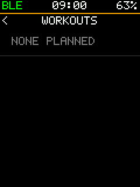

# bryton-rustfw

An open, from-scratch firmware in safe Rust for the **Bryton Rider S510** bike computer. It replaces Bryton's OS
entirely. Not affiliated with Bryton.

| | | | |
|:-:|:-:|:-:|:-:|
|  |  |  |  |
| Overview: time, date, four fields, notices (sim) | Start: the ride, said in a banner at the top (sim) | Power: 3 / 10 / 30 s, NP, IF, TSS (sim) | Graph of W' balance; a tap goes to the next plot, never while recording (sim) |
|  |  |  |  |
| Power graph with its axes, over the HR graph (sim) | DFA a1 and RMSSD from the strap's beats (sim) | An uneven layout: a big box over 2 x 2 (sim) | SETTINGS > ME: values with their units, edited in place (sim) |
|  |  |  |  |
| The ride's card when it ends: map, profile, numbers (sim) | Map with the track (sim) | Sensors and built-in readings (unit) | GPS (sim) |
|  |  |  |  |
| History: stock's rides, newest first (sim) | A past ride's card, read from its file (sim) | A planned workout's steps, from stock's calendar (sim) | A workout running: target, step left, next (sim) |
|  |  |  |  |
| A course followed: the line under the track (sim) | The course profile: climbs by grade, the rider's place (sim) | Distance to go, off course, the climb ahead (sim) | Courses on the card: stock's routes, FIT, GPX (sim) |
|  |  |  |  |
| The workout graph: steps by target and zone, the rider's place (sim) | The workout gauge: 3 s power on the step's band (sim) | The menu: what to ride, what was ridden, then the set-up; 44 px rows, a tap selects then acts (sim) | A page's field: its group, then the field (sim) |
|  |  |  |  |
| The map over IGN pack tiles, "(c) IGN" in the corner (sim, synthetic tiles, not a map) | The phone's media remote: what plays (AMS), the keys (sim) | An incoming call from the phone (ANCS): the banner at the top, the buttons name their keys (sim) | The map zoomed in with "+" and "-", panned by a drag, the crosshair to follow again (sim, synthetic tiles) |
|  |  |  |  |
| Page held during a ride: the ride menu, only what a rider does on the road (sim) | SETTINGS: a menu per subject, any setting three levels down at most (sim) | The page editor: a box held, framed in orange, live values, the hint in the strip's place (sim) | Start in the editor: the box's actions, SPLIT across or down by their icons (sim) |
|  |  | | |
| A page made in the editor: a graph over four values (sim) | Eight fields, four rows of two (sim) | | |
|  |  |  | |
| The touch lock: a padlock in the strip (sim) | A zone as a bar on the box's top edge (sim) | An empty list says so in a row (sim) | |

*"unit": a screenshot of the bike computer over USB (`./dev.py shot`, rendered by the firmware from what it drew);
"sim": the same firmware code drawing in the host simulator.*

**Status (2026-10-24):** runs on the unit (installed, and newer builds from RAM). An overview and ride pages in eleven
layouts, touch and keys, menus, ANT+ sensors (heart rate tried), derived power metrics (NP, TSS, W' balance...) and
heart rate variability (DFA a1), graphs, GPS with fast aided starts, a track map with a basemap (IGN Plan v2 packs, else stock's cached tiles), battery, backlight
with an automatic mode, beeps, the workouts stock's app synced (steps, targets, 3-2-1 beeps), courses with climbs (stock's routes, FIT, GPX), and a USB dev link. Rides are not saved yet: the FIT writer is ready, the eMMC driver
reads but does not write yet. It shares the storage with Bryton's firmware, so the two can be swapped.

| Read | For |
|---|---|
| [docs/features.md](docs/features.md) | what it does, screen by screen |
| [docs/checklist.md](docs/checklist.md) | every feature of stock, the patches and other bike computers, ticked as it lands |
| [docs/install.md](docs/install.md) | build, the ANT+ key, install, and the way back to stock |
| [docs/status.md](docs/status.md) | what is not yet seen on the unit, next steps |
| [docs/journal.md](docs/journal.md) | what was found on the unit, dated |
| [docs/roadmap.md](docs/roadmap.md) | what to build next, in dependency order |
| [docs/boot.md](docs/boot.md) | how it starts, from the bootloader's hand-off |
| [BOARD.md](BOARD.md) | the hardware: pin map, timing diagrams, every chip, with evidence |
| [AGENTS.md](AGENTS.md) | how to work on it: rules, tests, the dev loop |

It replaces the OS. Rides are saved to `\\Activities` as stock does (seen on the unit); no updates come from this firmware. The way back is the
bootloader's recovery mode, which this firmware cannot touch ([docs/install.md](docs/install.md)).
