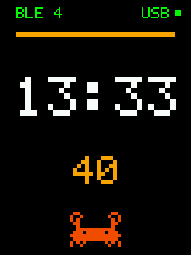

# bryton-rustfw

An open, from-scratch Rust firmware for Bryton bike computers. It currently targets the **Bryton Rider S510**,
as a proof of concept: it replaces Bryton's OS entirely, with ride pages fed by ANT+ sensors. Not affiliated with
Bryton.

- **Screen:** a thin status strip at the top (BLE, GPS, the time, a USB dot, the battery), then the main screen (the
  time, big, and Ferris the Rust crab) and up to three ride pages of 1, 2, 3, 4 or 6 fields (speed, heart rate,
  cadence, power, time, map), set from the menu; page 3 is the map by default. Everything is in the project's own
  dot-matrix font.
- **Map:** the ride's track from the GPS fixes (since power-on), north up, scaled to fit the whole track, an arrow
  for the position and heading, a scale bar. It is fitted again (one full redraw) only when the position nears the
  edge; otherwise only the box around the new segment and the arrow is redrawn (src/map.rs). No basemap yet.
- **Keys:** Page goes from the main screen through the ride pages and back; hold Page for the menu (in menus: Page / Lap move, Start selects or
  changes a value, Back goes back). Back toggles the backlight; held 3 s it switches off (standby). The power
  button starts it again, and power off also switches the radio chip off.
- **Menu:** sensors (Start searches and pairs the first one heard, Start again forgets it), the three pages
  (field count and each field), the wheel size, GPS (fix, satellites, position, altitude, UTC) and the BLE
  devices nearby.
- **GPS:** the u-blox M10 is on while the unit is; "GPS" blinks grey in the strip while it searches; with a fix,
  signal bars take its place (1 to 4, from the satellites used). Without a paired speed sensor, the speed comes from it. At power-up it gets the time (UTC, from the RTC)
  and the last position, and predicts orbits itself (AssistNow Autonomous), for a faster fix.
- **ANT+ sensors:** heart rate, speed, cadence, speed and cadence, power, on stock's channels. A paired sensor is
  kept through power off, so a friend's is never taken. Needs the ANT+ network key, which you copy from your own
  stock firmware (see "ANT+ key" below).
- **Devices nearby:** a 10 s BLE scan; one row per device, strongest first: its name, or in grey what kind of
  device it is ("iPhone/Mac", "AirPods", "Find My", "Windows PC"...: phones and laptops advertise no name, only
  manufacturer data and an address that changes every few minutes), else its address; and its signal strength.
- **USB cable in:** a dev link starts. It's a serial port carrying `dev.py` commands: info, screenshots, run a
  build from RAM, reset. A dot and a "USB" label at the top right show its state (orange, then green when ready;
  red if the PHY did not come up). Unplugging resets the unit.

- **Code:** a 48 KB image, of which about 20 KB is the USB stack and 2 KB the pixel font; no interrupts.
- **Sources:** every register is traced to [BOARD.md](BOARD.md) (the board, learned from the stock firmware) or
  the STM32H747 reference manual (RM0399).
- **Safe Rust** except `src/hw.rs` (register access, reset, RAM-run). How to work on it: [AGENTS.md](AGENTS.md).

**Status: runs on the unit (2026-10-23).** Installed on the eMMC, it starts straight into the clock (much faster
than stock), the keys work, holding Back powers off and the power button starts it again. The USB dev
link works (`info`, `shot`, `peek`, and `run` from RAM). The first install had stopped at the panel: SPI1 lost
master mode to a mode fault (see "First run on the unit" below).

*Screenshot taken from the unit over the dev link (`./dev.py shot`): rendered by the firmware from what it drew.
Everything is in the project's own pixel font, drawn at 2x to 7x like Ferris. The first frame ever, with the
earlier seven-segment digits: [docs/first-frame-2026-10-23.png](docs/first-frame-2026-10-23.png).*

## Build

    ./check.sh          # fmt, clippy, host tests, build, pack -> out/IMG.bin (1 MB + trailer), out/update.ini;
                        # plus the Renode checks when RENODE points at Renode (AGENTS.md, Emulation)

rustup installs the pinned toolchain and target on first use. `cargo test-host` alone runs the tests and draws
the screen through a simulated panel into `target/sim/preview.bmp`.

`pack.py` re-checks what the stock updater checks (raw tag "R039" at 0x94, size > 1 MB, additive-sum trailer)
and that the vector table is sane (SP in DTCM, Thumb reset vector inside the image).

### ANT+ key

ANT+ sensors (heart rate) use a network key that is licensed under the ANT+ adopter terms, so it is not in this
repository. The stock firmware carries it, and you can copy it from your own copy of the stock image:

    tools/fetch_firmware.py        # once: the stock image into firmware/R039/IMG.raw (gitignored)
    tools/ant_key.py               # finds the key in it (by its SHA-256) and writes ant_key.bin (gitignored)
    ./check.sh                     # build.rs builds the key in when ant_key.bin exists

Without `ant_key.bin` the firmware builds without ANT+ (no heart rate; BLE works). A build with the key is for
your own unit: don't publish its `out/IMG.bin`. `touch ant_key.bin` if you add it back with an old date (cargo
only rebuilds on a newer file).

## Try it, and go back

This **replaces the OS**: no USB drive, no rides, no updates from this firmware. The way back is the bootloader's
recovery mode, which this firmware cannot touch (it lives in the internal flash).

1. With the stock (or patched) firmware: plug in, copy `out/IMG.bin` and `out/update.ini` to the BRYTON drive,
   eject, unplug. The stock OS installs it while starting up (as for any update), then restarts into it.
2. Expected: black screen with the orange bar, the time in white, the seconds in orange, ticking. If the screen
   stays dark, press Back once (backlight polarity).
3. Back to Bryton's firmware (tested on the unit):
   - USB plugged **first**, then press the four buttons to restart, keep holding **Page** until "Engineer Mode"
     (without the cable the bootloader ignores Page).
   - Then `sudo python3 tools/iaprecover.py --write-vanilla` (copied from
     [bryton-S510-mods](https://github.com/taladjidi/bryton-S510-mods), see its `docs/recovery.md`; run
     `tools/fetch_firmware.py` once to get the stock image, which is not in this repository).
   - Or, to try a new build without the stock OS: `sudo python3 tools/iaprecover.py --write out/IMG.bin`. It
     checks the image as `pack.py` and the updater do, writes it in 2 KB chunks and reads each one back.
   - Restart, then install any firmware as usual.

Once installed, later builds don't need steps 1 and 3. With the cable in and the dot green, `./dev.py run` loads
`out/IMG.bin` into RAM and runs it, `./dev.py shot` / `watch` take screenshots, and `./dev.py reset` (or
unplugging) returns to the installed build. See AGENTS.md, "Development loop on the unit".

## First run on the unit (2026-10-22)

- **Installed** through the stock updater. Read back from Engineer Mode: bytes 0..0x100003 of the OS area are
  exactly `out/IMG.bin`, trailer included; the rest still holds the old OS image (never read).
- **Result:** dark screen, keys ignored, no USB device. So it stops before the first frame and before the USB
  start.
- **Diagnostic builds** (branch `diag-boot`, merged into main on 2026-10-23, written from Engineer Mode with
  `tools/iaprecover.py --write`; each write is a row in bryton-S510-mods' FLASHLOG):
  - v1 to v8 used the backlight (PG13 as a plain output) as the readout. v1 to v4 showed a steady light, v5 to v8
    nothing, whatever the code did with the pin: **PG13 as a plain output is no readout**, and the v1 / v2 "stop in
    the MPU writes" read from it is unproven.
  - **The signal that works (v9):** the image waits for USB power (PC13 high) and then resets. Power on, hold
    Page, plug the cable in: Engineer Mode appears. Control: with v8 (no reset) the same gesture gives no
    Engineer Mode, so the plug-in alone does not restart the unit. **So our code runs:** the bootloader hand-off,
    the reset handler, I-cache enable, GPIO input and the system reset all work.
  - **Where the full firmware stops** (the same checkpoint at chosen stages, v10 to v15): MPU, cycle counter,
    clocks and pins, SPI init, `delay_ms` (SysTick + WFI), one SPI byte and the panel power-on all pass. A long SPI
    write (2000 bytes) after the panel power-on does not complete, with SPI1 in endless mode (TSIZE 0) or per
    transfer (TSIZE + EOT, as stock). Renode runs the same images to the end. So every byte of the first frame
    waits out its timeout: the firmware looks hung. Stock never sends long SPI writes (pixels go over the LTDC).
  - v16 coded the result in the delay before the reset: SPI1 took exactly 16 bytes (its FIFO) and never clocked,
    with the panel off or on.
  - **The cause (2026-10-23, found over the dev link):** v17 skips a stuck panel and starts USB; `dev.py peek`
    showed SPI1 CFG2 without MASTER. `spi_init` wrote CFG2 (MASTER, SSM) while CR1.SSI was still 0: a mode fault,
    which clears MASTER. Clocks and pins were right. With SSI written first, the firmware runs on the unit:
    the screen shows the clock, the dev link works, and `dev.py run` starts a new build from RAM.
  - **Power on from standby (2026-10-23):** the power button drives PA0 (WKUP1) and PA1; PA0 was left in its
    reset analog mode, so the press never woke the unit (only the four-button restart did). Found with `peek` /
    `poke` (BOARD.md 9); with PA0 configured as an input (57ab570, installed), power off and on work.
- **The bootloader jumps with both caches off** (BOARD.md 2): the firmware runs uncached from SDRAM until it
  turns the I-cache on.
- **Renode passed all of these:** it does not model the MPU, the caches or the SPI mode fault (BOARD.md 2, 6).
- **The four-button restart works with this firmware stuck**, so Engineer Mode stays reachable (cable in first).

- **The Nordic BLE / ANT chip answers (2026-10-23):** first driven from the computer through the dev link
  (`tools/nrf.py version`), then by the firmware itself (`src/nrf.rs`): at start it resets the chip as stock
  does, enables BLE and reads the version, shown as "BLE 4" at the top left (BOARD.md 11). A 10 s scan at start
  counts the advertisers around (6 during the scan, 12 at its end on the first run), and power off sends
  `sd_power_system_off`. `tools/nrf.py scan` lists them with RSSI and names from the computer. To see: that the
  chip comes back after a power off and on (the reset pulse should wake it from System OFF; inferred so far).
- **ANT+ and the device list (2026-10-23, from RAM):** the ANT heart-rate channel opens as stock opens it (every
  command answered 0) and the list page shows 7 devices after its 10 s scan, with the channel open. A Page press
  sent over the dev link (`dev.py page`) first froze the main loop: the app's own `delay_ms` inside the sleep
  had taken over its SysTick period, so the loop never woke (only USB was still served). App work now runs after
  the sleep.
- **Unaligned reads from the SDRAM are wrong (2026-10-23):** page 2's default fields showed garbled. Reading the
  app's state in DTCM with `dev.py peek` showed a 7-byte constant copied wrong from SDRAM; the image itself was
  right. Built with `+strict-align` since (BOARD.md 2).
- **The GPS receiver did not start after a cold boot (2026-10-23, first install with GPS):** powered ~100 ms after
  its power line went from undriven (after reset) to low, it never answered. Reproduced with `peek` / `poke`
  (pins analog for 3 s, then a RAM run); now powered 1 s after the app's first step (BOARD.md 13).
- **GPS (2026-10-23):** the receiver is a u-blox M10 on SPI4 and already sends NAV-PVT after stock (BOARD.md 13);
  explored with `tools/gnss.py` (peek / poke), then the firmware's driver.
- **Pixels two per 32-bit SPI write (2026-10-23):** the panel shows everything right (the owner, by eye), so the
  byte order of SPI FIFO packing is as RM0399 says.
- **eMMC, read only (2026-10-23):** the driver identifies the card (31.3 GB), its OS area equals the installed image,
  and sector 0 is a FAT32 boot sector with no MBR (BOARD.md 15).
- **Battery (2026-10-23):** ADC3 reads the battery against VREFINT as stock does; 99 % while charging, in line with
  stock's last stored reading. Three quirks found with `peek` / `poke` (BOARD.md 12).
- **Heart rate and pairing (2026-10-23, from RAM, the owner's strap):** "HR 58" to "HR 70" from the strap
  (once wetted). The first strap heard is paired: its ANT channel ID (device 25126, transmission type 0xf1, read
  with op 0xd4) goes into RTC backup register 5, which kept it through a reset; the next start opened the channel
  for that strap only. `dev.py repair` (a long Page hold) cleared it and paired again.

## Not yet seen on the unit

Seen on 2026-10-23: pixels over SPI with RAMCTRL `B0 00 F0`; USB at high speed (PHY enable on PA7, the ULPI pins)
with the dev link; `dev.py run` from RAM; the SysTick + WFI sleep; the backlight on PG13; the RTC
holds local time; power off reaches standby (D1 / D2 reset flags) and the power button wakes it once PA0 is an
input. Still to see:
- A GPS fix (the receiver answers and reports, indoors without satellites), and how much the aiding at power-up
  shortens the next one.
- The start and stop beeps (TIM1 on PA10, BOARD.md 14): to hear.
- The backlight PWM levels and time-out (LPTIM1, as stock), each level by eye.
- The I-cache from a cold boot (seen from RAM: stable, ride page 0.5 % -> 0.2 % awake, GPS menu 2.2 % -> 1.3 %).
- The map on a real ride (simulated: 8 full redraws in a 14 min ride out and round a loop, 660 pixels/s between
  them), and the awake time it costs on the map page.
- Speed, cadence and power sensors (the decoders follow the ANT+ profiles; only the heart-rate strap was tried).
- Charging control: the charger is on whenever USB is in (as the bootloader leaves it), with no temperature
  window yet (BOARD.md 12). The low-battery switch-off (3.3 V) has not been reached on the unit.
- The Nordic chip coming back after a power off and on (`sd_power_system_off`, then the reset pulse).
- The OTG_HS IRQ waking WFI (the link may be running on the 50 ms SysTick wake-ups alone).

## How it starts (verified)

- **Bootloader** (BOARD.md 2):
  - copies 6 MB of the eMMC OS area to SDRAM 0xd0000000;
  - sets MSP from word 0 and jumps to word 1;
  - never checks the image;
  - **sets up the MPU and caches before the jump.**
    - The MPU has SDRAM 64 MB no-execute plus 4 MB executable at 0xd0000000, and ITCM executable.
    - Our region has the highest number, so it takes priority.
  - no watchdog (no IWDG/WWDG in the stock OS either).
- **SDRAM:** the FMC SDRAM is set up by the bootloader (bank 2, no remap: `FMC_BCR1 |= FMCEN` only).
- **Code placement:** code and constants run from SDRAM, as the stock OS does before its own MPU setup.
- **MPU:** the firmware adds one MPU region over SDRAM (normal, not cached, executable) and only switches the MPU
  on. Switching it off would turn 0xc0000000..0xdfffffff into execute-never device memory under the default map.
- **Data and stack:** in DTCM.

## Hardware used (BOARD.md sections)

- **Panel** (6), ST7789-class, 240 x 320, on SPI1:
  - SCK PG11 AF5, MOSI PD7 AF5, CS PG10 (driven by hand), D/C PG9, reset PI3, power PG3 (inferred);
  - SPI mode 3, 8 MHz from HSI (per_ck), so it does not depend on which PLL outputs the bootloader left running;
  - the stock init sequence, except that the last RAMCTRL is `B0 00 F0` instead of `B0 10 F0`, so pixels are
    written over SPI (RAMWR) and the LTDC is not needed.
- **Backlight** PG13: a plain output, high = on (derived from the stock inverted LPTIM1 PWM; Back toggles it).
- **RTC** (8): TR/DR read after RSF. The stock firmware may keep UTC and add the time zone itself (not traced),
  so the hour can be off by the time zone.
- **Keys** (5): PA1 back/power, PE3 page, active low, polled every 50 ms.
- **Standby** (9): wake-up pin WKUP1 (PA0) rising, PWR_CPUCR PDDS_D2 + PDDS_D1, SLEEPDEEP, WFI, as the stock
  power-off.
- **Delays:** SysTick + WFI at 200 MHz (the bootloader's clock setup), so the CPU sleeps; the DWT cycle counter
  for timeouts.

## Next steps (for an open firmware)

1. Run it.
2. Then add, one at a time, each with its BOARD.md section written first:
   - battery voltage (ADC3);
   - the GNSS on SPI4;
   - the Nordic link on USART2 (nRF5 serialization; the deciding piece);
   - FAT on the eMMC (SDMMC1);
   - USB mass storage, so updates and recovery work from inside the firmware.
3. Embassy (async) once more than one thing runs at a time.
