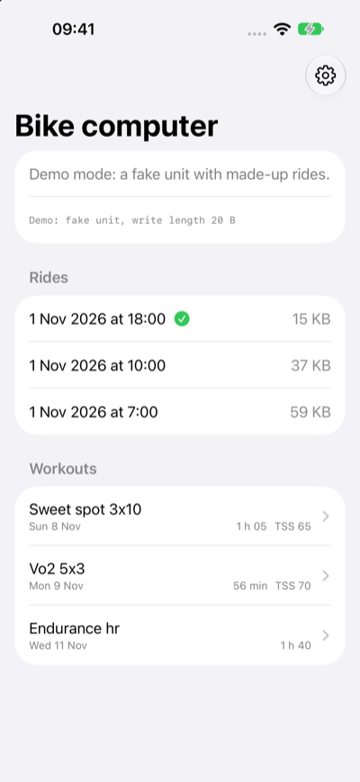
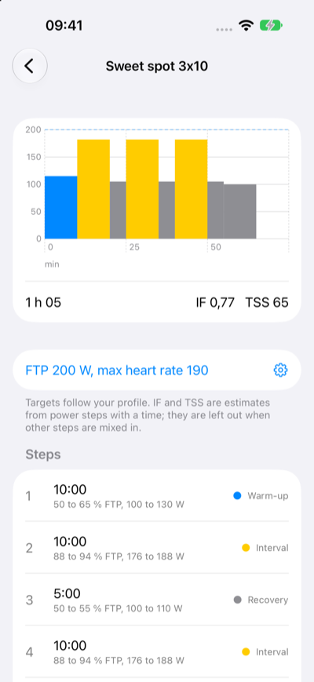

# The phone app

Walking skeleton (roadmap section 9, A2 and A3 started): an iPhone app that finds the bike computer, reads its
Battery Level (0x2A19) and Manufacturer Name (0x2A29) and shows them. The bytes are decoded by a Rust core
(`app/core`, UniFFI), so the app and the unit share code; Swift only moves bytes from CoreBluetooth. The firmware
is unchanged: it already serves Battery 0x180F and Device Information 0x180A openly (HID is hidden from apps by iOS).

The unit advertises only while pairing, or bonded and not connected. When the phone already holds the link (the
notifications bond), the app asks the system for it with `retrieveConnectedPeripherals(withServices:)`, and scans
otherwise. It looks for the name "S510". Confirmed on the owner's iPhone (2026-11-07): the app shows S510, rustfw and
the battery, through `retrieveConnectedPeripherals`. The scan's filter on 0x180F is inferred: whether the unit's
advertisement carries 0x180F is not verified.

## Build

Needs Xcode 16 or later, Rust (the pinned toolchain, with `aarch64-apple-ios` and `aarch64-apple-ios-sim`).

    app/ios/build-core.sh          # core for both iOS targets, Swift bindings, XCFramework (app/ios/Generated)
    cd app/core && cargo test      # the core's tests, on the Mac
    xcodebuild -project app/ios/Bryton.xcodeproj -scheme Bryton -sdk iphonesimulator \
        -destination 'generic/platform=iOS Simulator' CODE_SIGNING_ALLOWED=NO build

The simulator has no Bluetooth: the app shows "This device has no Bluetooth". check.sh runs the core's clippy and
tests, and the simulator build when something under `app/` changed on a branch.

## Install on an iPhone with a free Apple ID

1. Xcode > Settings > Accounts: add your Apple ID (a personal team appears).
2. `cp app/ios/Local.xcconfig.example app/ios/Local.xcconfig`; set `DEVELOPMENT_TEAM` (your team id) and a
   `BUNDLE_ID_PREFIX` of your own. The file is gitignored.
3. On the phone: Settings > Privacy & Security > Developer Mode on (restart).
4. Run `app/ios/build-core.sh`, open `app/ios/Bryton.xcodeproj`, pick the phone, Run. On first launch trust the
   developer under Settings > General > VPN & Device Management.

The install lasts 7 days; Run again renews it. After one cable pairing, Xcode's "Connect via network" lets Run work
over Wi-Fi.

### First install, the traps

- Developer Mode appears in Settings > Privacy & Security only after Xcode has connected to the phone once.
- Xcode cannot mount its developer disk image while the phone is locked: keep it unlocked on the home screen.
- The first launch needs Settings > General > VPN & Device Management > Developer App > Trust.
- Installing from the terminal works (`<UDID>` from `xcrun devicectl list devices`):

      app/ios/build-core.sh
      xcodebuild -project Bryton.xcodeproj -scheme Bryton -destination 'id=<UDID>' -allowProvisioningUpdates build
      xcrun devicectl device install app --device <UDID> <path of Bryton.app in DerivedData>
      xcrun devicectl device process launch --device <UDID> <bundle id>

## The icon

Ferris the crab (the unofficial Rust mascot) riding a bike on a teal background: few shapes, bold outline, one
background, so it reads at 60 px. The dark variant swaps the teal gradient for a deep teal one, and the tinted variant
is its greyscale. Ferris is the artwork from https://rustacean.net, released to the public domain
(CC0 1.0, https://creativecommons.org/publicdomain/zero/1.0/; the site's footer says so), kept as
`app/ios/Icon/ferris-rustacean.svg`. The bike is drawn here and carries no brand mark. Edit `app/ios/Icon/icon.svg`,
run `python3 app/ios/Icon/render.py`: it writes the light, dark and tinted 1024 px PNGs (opaque, iOS rounds them)
into the asset catalog.

## Distribution

Build from source for now. TestFlight and the App Store need the paid Apple Developer account, and the App Store's
terms are to be checked against this project's GPLv3. The free route for others is an Android APK (step A4).

## Rides

The ride list and download (roadmap 9, A1 reads). `app/core/src/files.rs` is a sans-IO `FileClient`: Swift writes the
bytes it returns to Control (write with response) and feeds every Data notification to `onData`. Frames are encoded and
decoded by the firmware's own `src/link/filesvc.rs`; no chunk size is assumed (each CHUNK gives its length), so the
faster link needs no app change. The file is kept in memory; after BUSY, a link drop or 5 s of silence `resumeCommand`
asks READ again from the bytes kept. The final length is checked against LIST's size and END's count against the bytes
of the answer: a short file is an error, never a silent truncation.

The screen lists the rides (date and time from the `YYMMDDhhmmss` name, size in KB, a check mark when already saved),
pull to refresh; a tap downloads with a progress bar and KB/s, saves `<name>.fit` in the app's Documents (visible in
the Files app: `UIFileSharingEnabled`, `LSSupportsOpeningDocumentsInPlace`) and opens the ride viewer (below); a tap on a ride already saved opens it at once, and the viewer's share button opens the share sheet. A small line
shows `maximumWriteValueLength`, to read the negotiated MTU off the screen for the fast-link test.

**Demo** (the Simulator has no Bluetooth): the "Demo" button runs the same core against the Rust fake unit serving three
synthetic rides made by the firmware's FIT writer (an invented loop around the Eiffel Tower, a public landmark, no real data). Launch arguments `-demo` and
`-demo-dl` start it by themselves (`xcrun simctl launch booted <bundle id> -demo -demo-dl`, then
`xcrun simctl io booted screenshot`).

## The ride viewer

Roadmap 9, "Ride insights" (the owner's order of 2026-11-07: download speed first, then parity with Bryton's app).
`app/core/src/ride.rs` `analyze_ride(bytes, ftp, max_hr)` gives the viewer a `RideView`: the summary (times, distance,
ascent and descent, speeds, HR, power, cadence, NP, IF, TSS, kcal, laps, time in 5 HR and 7 power zones, best power
over 5 s, 1, 5, 20 and 60 min) and at most 2000 samples (time, position, altitude, speed, HR, power, cadence; per
bucket the first sample, the highest-power one and the altitude's lowest and highest, and always the last one, so
the graphs keep their peaks and reach the finish). NP, IF, TSS, kcal, the zones and
the curve are the firmware's own code (`power`, `power_curve`, `ride`), so the app and the unit agree. The FIT is read
with the `fitparser` crate (MIT), not the firmware's streaming `fitread`, which gives only the fields the unit shows
(no speed, cadence, calories, descent, lap start); a panic inside the crate is caught and reported as an unreadable
file. A ride whose CRC does not match (never finalized, damaged tail after a power cut) is read again without the CRC
checks, so it still opens. The tests cut and flip bytes in a ride over thousands of cases, with the CRCs made right
again so the damaged content reaches the viewer's code (and count the files opened and the ones refused), and call it
directly with odd records (no timestamp, no power, NaN, time going backwards, gaps).

The numbers are right for rides of this firmware or Bryton's with a record every second, and for smart-recording files
(1 to 10 s between records): each record counts for the time to the next one, at most 5 s, so zones, averages and NP
count seconds. Ascent and descent come from one method: the file's pair when it has a total_descent, else both from
the altitude samples with 3 m of hysteresis (this firmware's files have no total_descent).

The screen (`RideDetail.swift`, `RideMap.swift`): a grid of the metrics, the map, five Swift Charts graphs (altitude,
speed, HR, power, cadence) against distance or time, the laps, the zone bars and the power curve. Dragging on a graph
puts a marker on the map. The map is an `MKMapView`: inside France the base is IGN's Plan IGN v2 (WMTS
`https://data.geopf.fr/wmts`, layer `GEOGRAPHICALGRIDSYSTEMS.PLANIGNV2`, matrix set `PM`, no key; checked 2026-11-07),
elsewhere Apple's map (the IGN tiles are drawn over it, so where IGN has none Apple's shows). The map says "(c) IGN"
in its corner (IGN's Plan IGN v2 is open data under the Etalab Open Licence 2.0, which asks for the source to be
credited). The person icon opens FTP and max HR (UserDefaults, default 200 W and 190 bpm) until the unit's
profile can be read. Launch arguments `-demo` and `-demo-scroll graphs|laps` (Debug builds only) drive the Simulator screenshots.
The viewer needs iOS 17 (`chartXSelection`, the two-argument `onChange`; the project's deployment target is 17.0).

The static library the core builds into grew from 18.3 MB to 21.8 MB per target with `fitparser` (what the app
links is far less: the linker drops what is not called). `fitparser` takes `chrono` with its default features (the
clock, `iana-time-zone`): its Cargo.toml offers no switch, and a feature of a dependency cannot be turned off from the
outside, so that stays until the crate changes or is replaced.

| | | | |
|:-:|:-:|:-:|:-:|
|  |  |  |  |
| Summary and track on IGN | Graphs | Laps, zones, curve | Dark mode |

Screenshots from the Simulator (an iPhone 18 Pro, demo mode; the Xcode here had no iPhone 16 Pro simulator):

| | | |
|:-:|:-:|:-:|
|  |  |  |
| The ride list, demo mode | A download: bytes of the file, KB/s, cancel | The downloaded ride, share sheet (Save to Files) |

Not yet tried on a phone: that the service is found after `retrieveConnectedPeripherals` (the app discovers `aa3c0001`
itself), that the first Data subscription makes iOS encrypt with the stored bond, the speed over the real link.

## Workouts (read only)

The planned workouts on the unit, seen from the phone (roadmap 9; editing, which writes to the card, is a later step).
Stock keeps them in `\Workout\calendar\<YYYYMMDD>\<name>.fit`, long names and one folder a day, so the file service
gained folder commands: LIST_IN `04 seq folder` and READ_IN `05 seq folder off[4] len key (check[2])` name one of a small table
(0 `\Activities\`, 1 the workout calendar), never a path, with the same BUSY, bond and pacing rules (src/link/filesvc.rs,
src/app/filesvc.rs). A workout's key is ten digits: its day and its number among that day's `.fit` files (the long name
never travels: the name is read from the file). ENTRY_IN is `84 seq len key (check[2]) size[4]`; a workout's ENTRY_IN and
READ_IN carry a 16-bit check (the FIT CRC of the file's name as listed, then of its size, `filesvc::name_check`), a
ride's do not (they would pass the default MTU's 20 bytes). The key is a place in the directory order, so a folder that
changed between LIST_IN and READ_IN (a file added, removed or rewritten) answers NOT FOUND, never another file. Finding a
workout walks 200 entries of its day at most. LIST and READ are unchanged for the old app builds.

The app lists the workouts after the rides (`RideBrowser.refreshWorkouts`: LIST_IN, then each file whole, a few KB), and
decodes each with the firmware's own parser through `app/core/src/workout.rs` (`decodeWorkout(bytes, ftp, maxHr)`): name, time,
steps with repeats already written out, targets as the file gives them (% of FTP, watts, heart rate, cadence) plus the
watts and power zone for the rider's FTP, and an estimate of IF and TSS (4th-power mean over
time; the firmware has none) that is shown only when every step is a power step with a time (a distance, Lap, heart rate
or cadence step would leave it covering part of the workout). One workout that has gone from the unit since the list is
skipped; the others still load. The detail page draws a step chart (a bar a step at its target's middle, coloured by zone)
and lists the steps; the FTP and max heart rate are the profile sheet's (the same `ftp` and `maxHR` as the ride viewer; the detail page opens it).
`-demo-workout` opens the first workout in the Simulator.

| | |
|:-:|:-:|
|  |  |
| The list, demo mode (made-up workouts) | The detail: chart by zone, IF and TSS, steps |

## Seen on the unit, 2026-11-07

On the owner's iPhone 16 Pro (iOS 27):
- The app shows S510, rustfw and the battery.
- The unit's PHONE menu shows the FAST LINK row: the radio chip took the MTU 247 configuration.
- iOS negotiated ATT MTU 247: `maximumWriteValueLength` is 244 without response and 512 with.
- A 468,042-byte ride downloaded whole, byte-identical to the same file read over USB (`dev.py drive`, then `cmp`).
- Speed was about 3 KB/s, far below the simulator's 34 KB/s; after the event length 6 and the connection event extension it is 16.6 KB/s (below, and docs/status.md for the steps still owed).
- iOS keeps a stale GATT table after the unit switches firmware (no Service Changed characteristic yet): forget S510 and pair again fixes it; a RAM run's new bond lives only in RAM.

## Fast link: the chip app's layer and the speed model

Moved from docs/status.md (2026-11-07).

**Settled at the chip app's layer** (`src/sim/nrf_session_tests.rs`, the real app with a stub that decodes each
SoftDevice call; the stub answers 0 to anything, so whether the chip's RAM holds an MTU of 247 and a queue of 4 is not
known from it): the app knows every command the fast link sends and makes the intended call with the intended
arguments (cfg ids 0x20 / 0x40 / 0x23 att_mtu 247 / 0x22 queue 4 on tag 1, MTU reply 247, data length 251, 2M PHY,
parameter updates, 244-byte hvx, sys_attr_set of 64 bytes); it takes a command payload of 384 bytes and **hangs on
385** (nrf.rs MAX_CMD is 384; a notification is 260); four 260-byte notifications back to back are all taken; it
encodes the MTU request (0x55), HVN TX complete (0x57, with its count), connection parameter update / request, PHY and
data length requests and updates, and a 244-byte GATTC hvx (258 bytes, within KEPT 264) and our parser decodes them;
the phone setup registers exactly 10 vendor bases. Through the real app the UART path moves 400 KB in 7.95 s (50 KB/s,
8 notifications per 10 ms pass; 68 KB/s back to back, 1 Mbaud), faster than the simulator's chip model (34 KB/s): the
UART is not the limit.

**Why the first unit run gave 3 KB/s** (2026-11-07): the simulator let a whole notification through an event whatever
the data length, and gave the 15 ms interval and the 2M PHY it was asked for. Changed after that: `nrf::FAST_EVENT_LEN`
6 (7.5 ms), the connection event length extension (`sd_ble_opt_set` 0x67, `BLE_COMMON_OPT_CONN_EVT_EXT` id 2, sent
after `sd_ble_enable` on the fast link; decoded by Bryton's real app without a hang, nrf_session_tests.rs), the PHY and
data length update events decoded (0x22, 0x24), and the simulator's radio now sends whole link-layer packets only while
they fit the event (at data length 27 a 244-byte notification costs ten packets, 1M: about 6.7 ms) and models the
extension. The model's estimate (packets of 676 us at data length 27 and 1M, ten to a notification; 30 ms interval):
event 3.75 ms about 4 KB/s, which is what the unit gave, so the unit probably ran at data length 27 and 1M; event 7.5 ms
about 9 KB/s; with the extension about 37 KB/s at 30 ms; with 251 and 2M granted 44 KB/s (the simulator,
`a_400_kb_ride_downloads...`).

**The second measurement** (RAM run of 20989f2a): 16.6 KB/s, `info` int 12 phy 2 dle 251 ext 1 boost 0 0 0, 1.2
notifications per connection event, 81 a second; 1152 of 1871 confirmations counted (TX_COMPLETEs kept while a command
waits are merged, `nrf::Rx::keep`). The step time is the 1871 sends and the loop slept only 10 ms between passes whose
events were read once; the chip's bytes now wake that sleep. The simulator's chip is more generous than the unit's
phone (it sends the queue's depth every event), so it shows 44 KB/s before and 54 KB/s after the wake, not 16.6.
`FAST_QUEUE` stays 4: nothing shows the queue to be the limit, and a chip that cannot hold 8 falls back to no fast
link.
