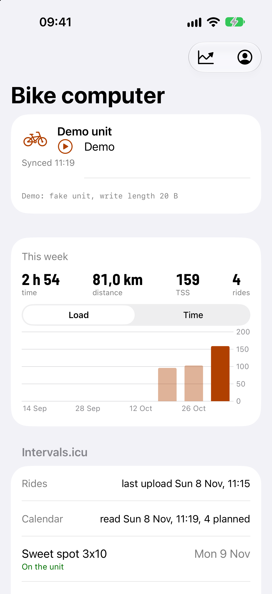
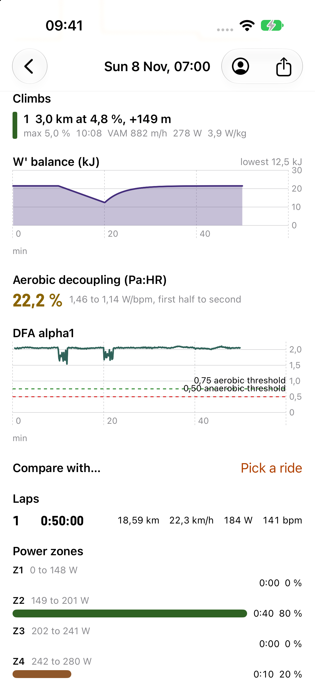
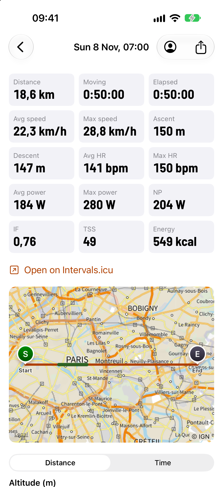
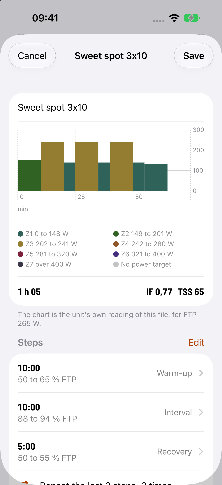
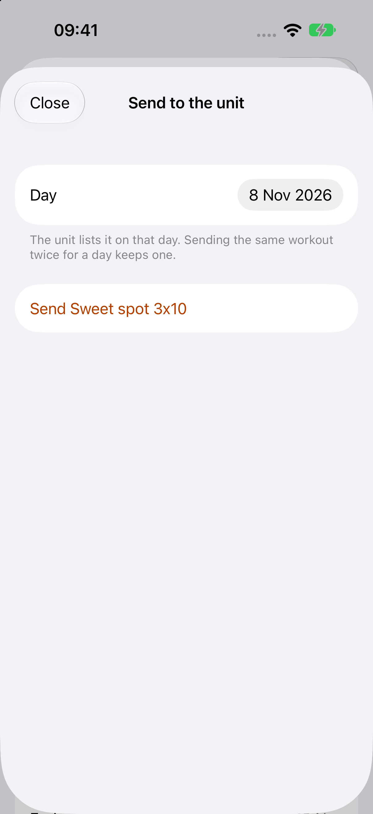
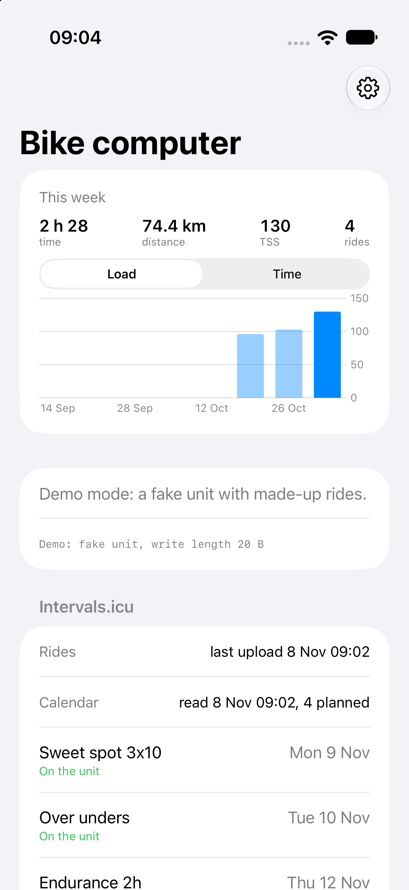

# The phone app

Walking skeleton (roadmap section 9, A2 and A3 started): an iPhone app that finds the bike computer, reads its
Battery Level (0x2A19) and Manufacturer Name (0x2A29) and shows them. The bytes are decoded by a Rust core
(`app/core`, UniFFI), so the app and the unit share code; Swift only moves bytes from CoreBluetooth. The firmware
is unchanged: it already serves Battery 0x180F and Device Information 0x180A openly (HID is hidden from apps by iOS).

The unit advertises only while pairing, or bonded and not connected. When the phone already holds the link (the
notifications bond), the app asks the system for it with `retrieveConnectedPeripherals(withServices:)`, and scans
otherwise. It looks for the name "S510". Confirmed on the owner's iPhone (2026-11-07): the app shows S510, rustfw and
the battery, through `retrieveConnectedPeripherals`. The scan's filter on 0x180F is inferred: whether the unit's
advertisement carries 0x180F is not verified.

## Look and feel

Reviewed 2026-11-08 (docs/review-app-ui-2026-11-08.md); part A is done: the colours and the numeral face are the
unit's, the numbers are formatted in one place, and the P1 findings are fixed.

- **Colour tokens**, one table in `app/core/src/theme.rs` (`TOKENS`), one Color Set per token in
  `app/ios/App/Assets.xcassets` (light and dark), read through `Tok` in `App/Theme.swift`. Tests fail when a colour
  set differs from the table, when a token that must equal the firmware's colour does not, or when a contrast falls
  under its rule (4.5:1 for text tokens, 3:1 for the zones, against the iOS card and background, light and dark):
  - light: `Theme::LIGHT` (src/ui/theme.rs): accent #B04000, zones #2F6259 #2F6223 #947D31 #8F572A #7C203B #442D7C
    #3C3748, ok #007000, warn #8A6400, alarm #D00000;
  - dark: accent `ACCENT` #FFA600, zones 1 to 4 `ZONE_COLORS` (src/training/ride.rs) #4A9284 #4A9231 #DEBA4A #D68242,
    zones 6 and 7 from `Theme::OUTDOOR` #885AF8 #786E90 (DARK's own are 3.1 and 2.8 on black), zone 5 lifted to
    #E0486F (DARK's #BD315A is 3.0); ok, warn and alarm are iOS's green, yellow and red (#30D158 #FFD60A #FF453A), the
    firmware's neon ones being too hard on a phone;
  - derived: `Tok.grade` = zones 2 to 5 by `grade_color`'s bands, `Tok.hrZone` = zones 1 to 5, `Tok.form` as
    `form_color` (ok, secondary, warn, alarm). Series: speed zone 1, heart rate zone 5, power the accent, cadence
    zone 2; red is never a series. Errors and warnings are a `Notice` (icon and text in warn or alarm).
- **Numerals** in Barlow Semi Condensed Bold, the unit's SMOOTH face (`App/Fonts/`, copied from `tools/fonts/`, SIL OFL
  1.1, text in Profile > Licences). `.numeral(.title3)` (`Theme.swift`) scales with Dynamic Type and turns on tabular
  figures (`tnum`; the font's default digits differ in width). Used for big numbers only (tiles, weekly panel, lap
  numbers, readouts, fitness); all text stays SF. The pixel font is not used: a 1 bit face at 2x is blurred on a Retina
  screen and does not scale.
- **Formatting** is `App/Fmt.swift`: decimals and dates follow the phone's region (French reads "28,8 km/h"),
  clock-style durations come from `app/core/src/fmt.rs` (tested there). No `String(format:)` for display anywhere.
- **Accessibility:** icon buttons, the map, the charts (label, lowest, highest, average) and the zone rows carry
  VoiceOver text; the viewer's tiles, laps and the weekly panel reflow at large Dynamic Type sizes.

## Build

Needs Xcode 16 or later, Rust (the pinned toolchain, with `aarch64-apple-ios` and `aarch64-apple-ios-sim`).

    app/ios/build-core.sh          # core for both iOS targets, Swift bindings, XCFramework (app/ios/Generated)
    cd app/core && cargo test      # the core's tests, on the Mac
    xcodebuild -project app/ios/Bryton.xcodeproj -scheme Bryton -sdk iphonesimulator \
        -destination 'generic/platform=iOS Simulator' CODE_SIGNING_ALLOWED=NO build

The simulator has no Bluetooth: the app shows "This device has no Bluetooth". check.sh runs the core's clippy and
tests, and the simulator build when something under `app/` changed on a branch.

## Install on an iPhone with a free Apple ID

1. Xcode > Settings > Accounts: add your Apple ID (a personal team appears).
2. `cp app/ios/Local.xcconfig.example app/ios/Local.xcconfig`; set `DEVELOPMENT_TEAM` (your team id) and a
   `BUNDLE_ID_PREFIX` of your own. The file is gitignored.
3. On the phone: Settings > Privacy & Security > Developer Mode on (restart).
4. Run `app/ios/build-core.sh`, open `app/ios/Bryton.xcodeproj`, pick the phone, Run. On first launch trust the
   developer under Settings > General > VPN & Device Management.

The install lasts 7 days; Run again renews it. After one cable pairing, Xcode's "Connect via network" lets Run work
over Wi-Fi.

### First install, the traps

- Developer Mode appears in Settings > Privacy & Security only after Xcode has connected to the phone once.
- Xcode cannot mount its developer disk image while the phone is locked: keep it unlocked on the home screen.
- The first launch needs Settings > General > VPN & Device Management > Developer App > Trust.
- Installing from the terminal works (`<UDID>` from `xcrun devicectl list devices`):

      app/ios/build-core.sh
      xcodebuild -project Bryton.xcodeproj -scheme Bryton -destination 'id=<UDID>' -allowProvisioningUpdates build
      xcrun devicectl device install app --device <UDID> <path of Bryton.app in DerivedData>
      xcrun devicectl device process launch --device <UDID> <bundle id>

## The icon

Ferris the crab (the unofficial Rust mascot) riding a bike on a teal background: few shapes, bold outline, one
background, so it reads at 60 px. The dark variant swaps the teal gradient for a deep teal one, and the tinted variant
is its greyscale. Ferris is the artwork from https://rustacean.net, released to the public domain
(CC0 1.0, https://creativecommons.org/publicdomain/zero/1.0/; the site's footer says so), kept as
`app/ios/Icon/ferris-rustacean.svg`. The bike is drawn here and carries no brand mark. Edit `app/ios/Icon/icon.svg`,
run `python3 app/ios/Icon/render.py`: it writes the light, dark and tinted 1024 px PNGs (opaque, iOS rounds them)
into the asset catalog.

## Distribution

Build from source for now. TestFlight and the App Store need the paid Apple Developer account, and the App Store's
terms are to be checked against this project's GPLv3. The free route for others is an Android APK (step A4).

## Rides

The ride list and download (roadmap 9, A1 reads). `app/core/src/files.rs` is a sans-IO `FileClient`: Swift writes the
bytes it returns to Control (write with response) and feeds every Data notification to `onData`. Frames are encoded and
decoded by the firmware's own `src/link/filesvc.rs`; no chunk size is assumed (each CHUNK gives its length), so the
faster link needs no app change. The file is kept in memory; after BUSY, a link drop or 5 s of silence `resumeCommand`
asks READ again from the bytes kept. The final length is checked against LIST's size and END's count against the bytes
of the answer: a short file is an error, never a silent truncation.

The screen lists the rides (date and time from the `YYMMDDhhmmss` name, size in KB, a check mark when already saved),
pull to refresh; a tap downloads with a progress bar and KB/s, saves `<name>.fit` in the app's Documents (visible in
the Files app: `UIFileSharingEnabled`, `LSSupportsOpeningDocumentsInPlace`) and opens the ride viewer (below); a tap on a ride already saved opens it at once, and the viewer's share button opens the share sheet. A small line
shows `maximumWriteValueLength`, to read the negotiated MTU off the screen for the fast-link test.

**Demo** (the Simulator has no Bluetooth): the "Demo" button runs the same core against the Rust fake unit serving three
synthetic rides made by the firmware's FIT writer (an invented loop around the Eiffel Tower, a public landmark, no real data). Launch arguments `-demo` and
`-demo-dl` start it by themselves (`xcrun simctl launch booted <bundle id> -demo -demo-dl`, then
`xcrun simctl io booted screenshot`).

## The ride viewer

Roadmap 9, "Ride insights" (the owner's order of 2026-11-07: download speed first, then parity with Bryton's app).
`app/core/src/ride.rs` `analyze_ride(bytes, ftp, max_hr)` gives the viewer a `RideView`: the summary (times, distance,
ascent and descent, speeds, HR, power, cadence, NP, IF, TSS, kcal, laps, time in 5 HR and 7 power zones, best power
over 5 s, 1, 5, 20 and 60 min) and at most 2000 samples (time, position, altitude, speed, HR, power, cadence; per
bucket the first sample, the highest-power one and the altitude's lowest and highest, and always the last one, so
the graphs keep their peaks and reach the finish). NP, IF, TSS, kcal, the zones and
the curve are the firmware's own code (`power`, `power_curve`, `ride`), so the app and the unit agree. The FIT is read
with the `fitparser` crate (MIT), not the firmware's streaming `fitread`, which gives only the fields the unit shows
(no speed, cadence, calories, descent, lap start); a panic inside the crate is caught and reported as an unreadable
file. A ride whose CRC does not match (never finalized, damaged tail after a power cut) is read again without the CRC
checks, so it still opens. The tests cut and flip bytes in a ride over thousands of cases, with the CRCs made right
again so the damaged content reaches the viewer's code (and count the files opened and the ones refused), and call it
directly with odd records (no timestamp, no power, NaN, time going backwards, gaps).

The numbers are right for rides of this firmware or Bryton's with a record every second, and for smart-recording files
(1 to 10 s between records): each record counts for the time to the next one, at most 5 s, so zones, averages and NP
count seconds. Ascent and descent come from one method: the file's pair when it has a total_descent, else both from
the altitude samples with 3 m of hysteresis (this firmware's files have no total_descent).

The screen (`RideDetail.swift`, `RideMap.swift`): a grid of the metrics, the map, five Swift Charts graphs (altitude,
speed, HR, power, cadence) against distance or time, the laps, the zone bars and the power curve. Dragging on a graph
puts a marker on the map. The map is an `MKMapView`: inside France the base is IGN's Plan IGN v2 (WMTS
`https://data.geopf.fr/wmts`, layer `GEOGRAPHICALGRIDSYSTEMS.PLANIGNV2`, matrix set `PM`, no key; checked 2026-11-07),
elsewhere Apple's map. IGN replaces Apple's map (a ride's whole track must be in France for it), and its tiles are
kept in memory and in a 200 MB disk cache: a pinch zoom asks again for every level it passes, and with Apple's map
under the tiles it showed through until the zoom stopped (seen on the owner's iPhone, 2026-11-08). The map says "(c) IGN"
in its corner (IGN's Plan IGN v2 is open data under the Etalab Open Licence 2.0, which asks for the source to be
credited). The person icon opens FTP and max HR (UserDefaults, default 200 W and 190 bpm) until the unit's
profile can be read. Launch arguments `-demo` and `-demo-scroll graphs|laps` (Debug builds only) drive the Simulator screenshots.
The viewer needs iOS 17 (`chartXSelection`, the two-argument `onChange`; the project's deployment target is 17.0).

The static library the core builds into grew from 18.3 MB to 21.8 MB per target with `fitparser` (what the app
links is far less: the linker drops what is not called). `fitparser` takes `chrono` with its default features (the
clock, `iana-time-zone`): its Cargo.toml offers no switch, and a feature of a dependency cannot be turned off from the
outside, so that stays until the crate changes or is replaced.

| | | | |
|:-:|:-:|:-:|:-:|
|  |  |  |  |
| Summary and track on IGN | Graphs | Laps, zones, curve | Dark mode |

Screenshots from the Simulator (an iPhone 18 Pro, demo mode; the Xcode here had no iPhone 16 Pro simulator):

| | | |
|:-:|:-:|:-:|
|  |  |  |
| The ride list, demo mode | A download: bytes of the file, KB/s, cancel | The downloaded ride, share sheet (Save to Files) |

Not yet tried on a phone: that the service is found after `retrieveConnectedPeripherals` (the app discovers `aa3c0001`
itself), that the first Data subscription makes iOS encrypt with the stored bond, the speed over the real link.

## Deeper analysis (roadmap 10)

`app/core/src/insight.rs` `ride_insight(bytes, weight_kg, cp, wprime_j)` reads the file again (all records) and gives
the climbs, the W' balance, the decoupling and DFA alpha1. The app runs it once per ride off the main thread
(`InsightCache`, in memory for the session, keyed by file, size and profile) so the page opens at once and the sections
appear when it is done. The firmware's code does the maths (two small visibility changes: `Course::climbs_of` and
`power::wbal_step`, the W' step `Power::second` now calls too).

- **Climbs:** `course::Course::climbs_of`, the unit's one definition (Garmin ClimbPro's rule, 500 m at 3 % or more, found
  on the profile in 50 m steps; docs on the road ahead say the same). The ride's altitude is resampled every 10 m and
  smoothed by a 100 m moving average first, since the finder was made for the smooth profile of a planned course.
  Per climb: length and gain from the finder, average grade (gain / length), maximum grade over 100 m of the smoothed
  profile, time (first to last record in it, stops included), VAM (gain / time, m/h), average power and W/kg (the
  profile's weight). Colour: `ui::grade_color` of the average grade, the unit's bands. The climb is drawn in that colour
  on the map (`ClimbLine`) and over the altitude graph.
- **W' balance:** `power::wbal_step`, the differential model (Froncioni and Clarke, Golden Cheetah "Differential"; the
  unit's `Power::second`), second by second from a full W' (at most 3 days of it, so a damaged timestamp cannot make it
  long), a record counting for up to 5 s and then 0 W. CP = FTP is the unit's own shortcut, not the rider's critical power:
  a W' from Intervals.icu belongs to its CP, so the two differ when CP and FTP do. Graph of the lowest value per bucket;
  "lowest" is the ride's minimum.
- **Aerobic decoupling (Pa:HR from power):** moving seconds with power and a heart rate above 0 (0 is a dropout) cut in
  two halves of equal time; EF = average power / average HR per half; decoupling = (EF1 - EF2) / EF1 x 100. This is
  Friel's Pw:Hr / Pa:Hr with the average power of each half. Intervals.icu's own definition is **unverified (one forum
  user's reply, <https://forum.intervals.icu/t/21505>)**; average power is taken for consistency with Intervals.icu,
  which the owner compares against (NP would differ by the variability of each half). Under 20 minutes of moving time
  no value is shown (inferred). Under 5 % is shown green, the usual mark of aerobic fitness (inferred, not a diagnosis).
- **DFA alpha1:** the file's `hrv` messages (global 78, `time`; the raw RR the firmware writes in the full copy) through
  the firmware's `hrv::Hrv` (5 % artifact rule, 2 minute window, boxes of 4 to 16 beats), the beats laid end to end from
  the first record (the messages carry no time). Dashed lines at `hrvt::A1_VT1` 0.75 and `A1_VT2` 0.5. A ride without
  the beats shows no DFA chart. The demo ride has made-up beats from its heart rate with 3 % of variation, so its alpha1
  is not physiological.
- **Compare with...:** a menu of the other downloaded rides; the two power curves side by side (durations the
  ride held), and the climbs both share: `match_climbs` pairs climbs whose start and end are each within the larger of 150 m
  (`climbs_ahead::SNAP_M`) and a quarter of the shorter climb's length of the other's, the pairs with the least summed
  distance first, each climb once, with both times and the difference. (A "70 % of the length in common" test is not
  done: it needs the tracks.) The curve chart's x axis is every duration either ride held, in order. Two quick picks
  cancel the first. The cache keeps the last 8 rides, and two askers of one ride share one run.

Core tests: the demo hill ride (a 3 km climb at 5 %) gives one climb with its numbers, W' balance against a hand case
(100 s at 300 W over a CP of 200 W with a 20 kJ W' is 10 000 J, then 50 J back in the next second at 100 W), decoupling of a
constructed ride (1 - 140/147), DFA from the file's beats, climb matching (at the tolerance's edge), a noisy hill (one
climb), a noisy flat and a reversed ride (none), and a fuzz of the analysis (records with missing, NaN, huge, repeated
and backwards values, files with flipped bytes) that counts it reaches climbs, W' balance, decoupling and DFA. The demo's first ride is now this hill ride.

| | |
|:-:|:-:|
|  |  |
| Climbs, coloured by grade | Fitness (demo) |

## Fitness (roadmap 11)

The chart icon on the main screen opens `FitnessView`. With an Intervals.icu key (the profile's) it fetches, through
`IntervalsClient.get`, `GET /api/v1/athlete/{id}/wellness.json?oldest&newest` (CTL, ATL, `sportInfo[].eftp`) and
`.../power-curves.json?curves=90d&type=Ride` (OpenAPI spec, <https://intervals.icu/api/v1/docs>, looked up 2026-11-08;
that "90d" names the last 90 days is **inferred** from the site's curve names, as are the units of eftp). The parsers
(`fitness.rs`, tested with synthetic answers with missing and wrong fields, and fuzzed) skip a day without id, CTL or
ATL; a day is checked against its month's length; powers (eFTP, the curve) are clamped to 3000 W, not dropped; TSB uses the
day before only if it is the previous calendar day. Without a key, or when Intervals.icu cannot be reached (the screen says so), CTL and ATL come from the loads of the
rides this phone holds: the firmware's model (`load.rs`, Coggan's PMC) with exponential averages of the daily load,
`x[d] = x[d-1] + (load[d] - x[d-1]) / N`, N = 42 and 7, starting at 0 on the first ride (so it needs about 6 weeks of rides), and the screen is labelled "From
this phone's rides". The fetch is keyed on the key and athlete only, so a new ride or FTP does not ask again; the screen says
when its last day is older than yesterday. TSB is the form the day starts with, yesterday's CTL minus ATL, for both sources. eFTP and the power
curve need Intervals.icu; the screen always says which source it shows. Launch argument `-demo-fitness` (Debug) opens it;
`-demo-open` opens the first downloaded ride's page.

## Ride list and weekly totals

The main screen opens with this week's time, distance, load (TSS) and ride count, and the last 8 weeks as bars (load or
time; touch a bar to read that week). Each ride row shows its start in the phone's zone and "2 h 31 · 68.4 km · TSS 112".
The numbers come from the ride's file, so the app **syncs by itself**: with the unit connected and nothing else going on
it downloads the rides of the last 8 weeks, newest first, into the same Documents folder a manual download uses, then
reads each once (`ride_brief`) and caches the result in `ride-summaries.txt` (name, list size and one text line per ride).
A refresh, a send, a delete or a tap on a ride takes the link from the sync at once; cancelling a sync download stops the
sync until the next refresh; a reconnect resumes it; a ride on the phone is never downloaded twice. "Syncing 3 of 7" shows
while it runs, and the panel says how many rides of the period are not on the phone yet. Older rides download when
opened. The cache keeps the NP, the seconds and the heart rate histogram, so a new FTP or max HR (the profile sheet, which
says to keep the FTP equal to Intervals.icu's) recomputes every load at once without reading a file.

Definitions (`app/core/src/summary.rs` has the sources and what is inferred; looked up 2026-11-08). The numbers can
differ from Intervals.icu's for the same file:
- **Week:** Monday to Sunday, which a forum reply says is hardcoded in Intervals.icu. A ride counts in the week of the
  local day in the unit's file name (`YYMMDDhhmmss` is the unit's local time), else of its start in the phone's zone
  (inferred: Intervals shows an activity on its local start date).
- **Moving time:** a second counts when the speed is at or above the unit's auto-pause speed (2 km/h), so the phone and
  the unit agree (a test runs the same samples through the firmware's `Ride` and the viewer and compares TSS). Intervals'
  own threshold is not confirmed (a staff post is reported to give 0.05 m/s: inferred, not confirmed by the cited page).
  A ride with no speed field is all moving. Each record counts for the time to the next, at most 5 s. The viewer uses
  the same number; it no longer reads the file's timer time. The viewer's average power and calories still prefer the
  file's own values (which include stopped seconds); only when the file has none are they worked out, over moving seconds.
- **Distance:** the file's total distance (inferred).
- **Load with power:** TSS over the moving seconds with NP; a forum answer says Intervals' is TrainingPeaks' without
  stopped time. Its NP method is not confirmed to match (inferred). The FTP is the profile's.
- **Load without power:** Intervals' default is a regression on time in heart rate zones; the app approximates it with
  Banister TRIMP (rest 60 bpm, against an hour at 85 % of the max HR). It is not a TSS: rows say "HR load" and a week
  holding one says "TSS*".

The Demo unit's ten rides are dated relative to today over the last three weeks (Paris time), so the panel has bars.

## The iPhone app against the unit

iOS keeps a copy of the unit's GATT table for each bond. Our builds keep one table: the phone's services and
characteristics, in order, are frozen (`app/phone.rs`; the test `the_phone_gatt_table_is_frozen` in
`src/sim/phone_tests.rs` holds the 28 rows). After a switch to stock or to a build with a different table, the iPhone
forgets S510 and pairs again once: Settings > Bluetooth, tap (i) next to S510, Forget This Device; then on the unit,
PHONE > PAIR. The app says so when the file service is missing.

There is no Service Changed indication, which is the standard way to tell iOS. The SoftDevice raises
BLE_GATTS_EVT_SC_CONFIRM (0x54) after every indication, and Bryton's chip app hangs on it
(`nrf_emu_hangs_on_the_service_changed_confirm`, `tools/nrf_emu.py`). So the table stays stable instead.

## Workouts

The planned workouts on the unit, seen from the phone (roadmap 9), and since 2026-11-07 sent and deleted from it
(the firmware's side; the app's editor is the next step).
Stock keeps them in `\Workout\calendar\<YYYYMMDD>\<name>.fit`, long names and one folder a day, so the file service
gained folder commands: LIST_IN `04 seq folder` and READ_IN `05 seq folder off[4] len key (check[2])` name one of a small table
(0 `\Activities\`, 1 the workout calendar), never a path, with the same BUSY, bond and pacing rules (src/link/filesvc.rs,
src/app/filesvc.rs). A workout's key is ten digits: its day and its number among that day's `.fit` files (the long name
never travels: the name is read from the file). ENTRY_IN is `84 seq len key (check[2]) size[4]`; a workout's ENTRY_IN and
READ_IN carry a 16-bit check (the FIT CRC of the file's name as listed, then of its size, `filesvc::name_check`), a
ride's do not (they would pass the default MTU's 20 bytes). The key is a place in the directory order, so a folder that
changed between LIST_IN and READ_IN (a file added, removed or rewritten) answers NOT FOUND, never another file. Finding a
workout walks 200 entries of its day at most. LIST and READ are unchanged for the old app builds.

The app lists the workouts after the rides (`RideBrowser.refreshWorkouts`: LIST_IN, then each file whole, a few KB), and
decodes each with the firmware's own parser through `app/core/src/workout.rs` (`decodeWorkout(bytes, ftp, maxHr)`): name, time,
steps with repeats already written out, targets as the file gives them (% of FTP, watts, heart rate, cadence) plus the
watts and power zone for the rider's FTP, and an estimate of IF and TSS (4th-power mean over
time; the firmware has none) that is shown only when every step is a power step with a time (a distance, Lap, heart rate
or cadence step would leave it covering part of the workout). One workout that has gone from the unit since the list is
skipped; the others still load. The detail page draws a step chart (a bar a step at its target's middle, coloured by zone)
and lists the steps; the FTP and max heart rate are the profile sheet's (the same `ftp` and `maxHR` as the ride viewer; the detail page opens it).
`-demo-workout` opens the first workout in the Simulator.

**Writes** (firmware side, src/link/filesvc.rs, src/app/filesvc.rs, src/storage/workout_write.rs): the phone sends a
workout as WRITE_BEGIN `06 seq 01 day[8] size[4] crc[4]` (the day `YYYYMMDD`, the file's CRC-32 as gzip computes it),
WRITE_DATA `07 seq off[4] data` in order (14 bytes a frame at the default MTU, up to 238 on the fast link: Control
takes up to 244), then WRITE_END `08 seq`; DELETE `09 seq 01 len key check[2]` removes a workout LIST_IN gave. Every
answer is an END: WRITE_BEGIN's once the unit is ready, WRITE_DATA's only when refused, WRITE_END's with the size,
DELETE's with count 1. New statuses: 5 READ ONLY (a build without card writes, the RAM run's), 6 MISMATCH (the bytes
received are not the size or CRC given), 7 FULL. Only folder 1 and only a FIT workout file of 8 KB at most, which the
unit reads back from the card and parses before it shows; the unit names it `<CRC-32 in hex>.fit` in
`\Workout\calendar\<day>\` (the day folder made if missing; `\Workout\calendar` itself must exist), so sending the same
file twice writes it once. The bytes go to `\Rustfw\Inbox\WORKOUT.TMP` first and move into the calendar only once checked: a
power cut at any point leaves the calendar as it was or with the whole workout (at most one lost chain, the workout's clusters, which a
computer's fsck reports). BUSY during a ride or while the card is lent, and a ride that starts drops a write under way;
a write the phone stops feeding for 5 s is dropped. DELETE needs the key's check, so a folder changed since the list
answers NOT FOUND, never another file; it frees the file's clusters (a workout, not a ride: nothing is kept) and leaves
stock's `.json` beside it.

| | |
|:-:|:-:|
|  |  |
| The list, demo mode (made-up workouts) | The detail: chart by zone, IF and TSS, steps |

## Workout editor (phone side)

Workouts are made on the phone and kept in the app's Documents (`Workouts/<name>.fit`), listed in an "On the phone"
section under the unit's. The editor's "Send to the unit" button sends the draft (see "Send and delete" below). The core's `draft.rs` holds the model and the encoder:
- `WorkoutDraft` is a name and a flat list of items; an item is a step (length by time, distance or the Lap key; target
  none, power in % of FTP or watts, heart rate in % of max or bpm, cadence; intensity) or a repeat of the N items before
  it, T times in all. That is the file's own repeat step (`duration_type` 6, from step `i - N`), so repeats nest the way
  the firmware's reader expands them. "Until Lap" and "open" are one thing in FIT (`duration_type` 5).
- `encodeWorkout` writes the FIT file the unit's parser reads (the same writer as the Demo workouts) and refuses what the
  unit cannot take, with a message: a name over 15 characters or not printable ASCII, no step, over 64 items, over 96
  steps once repeats are written out (the reader's `STEPS`), a target or length out of range, a repeat that reaches
  before the first item. `draftPreview` encodes and decodes it with the firmware's parser, so the live chart, the IF / TSS
  estimate and the watts are the unit's own reading. `draftFromView` makes a draft from a decoded workout ("Edit a copy"):
  runs of equal steps (blocks up to 32 steps) are folded back into repeats, and the result is folded again so nested
  repeats come back nested. A copy of a stock file with over 64 steps and no equal runs can pass the 64 items: the
  editor then shows the refusal until some are removed.
- `import.rs`, `importWorkout(bytes, fallbackName)`: ZWO (Warmup, Cooldown, Ramp, SteadyState, IntervalsT, FreeRide,
  MaxEffort; a ramp becomes one step with a range, not sub-steps), ERG (watts) and MRC (% of FTP): each pair of points
  is a step, a slope a range step; an ERG with no `MINUTES PERCENT` header is watts. A file over the unit's limits opens
  anyway and the editor shows the refusal. Refused outright: over 1 MB, over 500 steps or points, an ERG time past 24 h,
  a ZWO power above 10 (watts in a fraction field); power 0 is a step with no target; UTF-16 files are decoded.
- The file: `file_id` (type workout, manufacturer development, product 0, time_created 0), `workout` (name, step count,
  sport cycling) and one `workout_step` per step, without a step name. The firmware's reader (`workout_file.rs`
  `wanted`) keeps only file_id type, the workout name and step fields 1 to 7 and 19 to 22, so the added and dropped
  fields change nothing for the unit. Checked with `tools/fit_check.py --workout app/core/target/workout.fit` (written
  by the core's test `the_encoded_workout_is_written_for_fit_check`) on 2026-11-07: fitdecode (CRC checked, no warning)
  and garmin-fit-sdk (integrity, no error) both read it: 1 file_id, 1 workout (Sweet spot, 4 steps, cycling), 4 steps.
- Tests: every target and length type round-trips through the firmware's parser, nested repeats, each limit, a fuzz over
  random drafts (every accepted one reads back exactly) and over mutated import files (extreme numbers, CRLF, a BOM,
  multi-byte text). `cargo test` in `app/core`: 41 tests.

The editor (`WorkoutEditor.swift`): name, the chart, a step list with add, reorder, delete, duplicate (swipe right) and
a form per step. It opens from "New workout", "Import from Files" (Files app, any file), a saved workout, or "Edit a copy"
on a unit workout's page. `-demo -demo-edit` opens a copy of the first demo workout in the Simulator (`-demo-saved` saves it).

| |
|:-:|
|  |

### Send and delete

"Send to the unit" (editor) opens a sheet: a day (today by default) and Send. The core's `FileClient` encodes the draft
(`write_command`: WRITE_BEGIN with the size and CRC-32), the app then hands out `write_next_command` frames sized from the
link's write length (14 bytes of data at the default 20, up to 238), one at a time, each after the stack confirmed the last write (`onWriteDone`), then WRITE_END; a progress bar shows the bytes sent and
the unit's workout list is read again afterwards. Swipe Delete on a unit workout asks first, then sends DELETE with the
key and check of the last list. Statuses become texts: read only build, full day, mismatch (send again), busy (a ride or
the card lent), no workout calendar yet (WRITE_BEGIN's NOT FOUND), workout gone (DELETE's). Both are refused while a
listing, a download or another write runs (`RideBrowser.phase`). Demo mode's fake unit accepts both (`-demo -demo-edit
-demo-send` opens the sheet, `-demo-send-go` also presses Send, Debug builds only; seen in the Simulator: the paced send at
a 20 B write length ends in "Sent"); its `Faults` can answer each status.

| |
|:-:|
|  |

## Courses from the phone

The unit's side (2026-11-08; the app's route screen and its GPX to FIT encoder are the next step). Folder 2 of the file
service is `\Courses\`, the folder the unit's COURSES menu lists after stock's `\PlanTrip` (src/link/filesvc.rs,
src/app/filesvc.rs, src/storage/workout_write.rs):
- LIST_IN `04 seq 02` lists its `.fit` and `.gpx` files, ENTRY_IN `84 seq 02 key[2] check[2] size[4]`: the key is the
  file's two-digit number in directory order, the check the one a workout's has (the FIT CRC of the file's name, then
  of its size), so a phone that knows the name it sent finds its course in the list. READ_IN `05 seq 02 off[4] 02
  key[2] check[2]` reads one.
- WRITE_BEGIN `06 seq 02 size[4] crc[4] len name[len]`: the name is 1 to 20 ASCII letters, digits, spaces, `-` and `_`
  (what COURSES shows), not first or last a space, not a Windows device name (CON, NUL, COM1...); the unit writes
  `<name>.fit` with a long name. 12 bytes and the name: 8 characters fit the default MTU's 20-byte write, the 20 any
  larger one (the core's `course_write_command` cuts the name to the write length). Then WRITE_DATA and WRITE_END as for
  a workout. The file must be a FIT course the unit follows (two points at least, read back from the card and parsed
  at WRITE_END: BAD REQUEST otherwise; the phone converts GPX), 1 MB at most (WRITE_END reads up to three times that
  in one pass, about 0.3 s; more points than the unit keeps).
- The same course sent again (same name, size and CRC-32) answers ok, written once; another file of that name (any
  case) is BAD REQUEST, never written over: delete it first. So is a name the COURSES menu would show for another
  course (a `.gpx` of the same name, a Bryton route in `\PlanTrip`, `_` for a space); and COURSES holding its 64
  courses (`\PlanTrip` and `\Courses` together) is FULL, so a sent course never misses from the menu. Both are
  answered at WRITE_BEGIN, before any byte is sent. A card without `\Courses` gets it made by the first course
  (never `\PlanTrip`: Bryton's own format, which its app manages).
- LIST_IN numbers the first 200 entries of `\Courses` only (READ_IN and DELETE reach no further), and up to 100
  files.
- DELETE `09 seq 02 02 key[2] check[2]` removes a listed course (entry marked deleted, then its clusters freed). The
  course being followed, or being read to follow, answers BUSY.
- Same rules as the workouts: the bond, BUSY during a ride or while the card is lent, READ ONLY in a build that may not
  write the card, a power cut anywhere leaves `\Courses` as it was or with the whole course (at most one lost chain,
  the course's clusters: up to 64 for 1 MB, never reclaimed by the unit, freed by a computer's fsck).
- The unit's COURSES menu lists the folder again after a course is written or deleted (at once when it shows, its
  cursor kept within the list; otherwise when it opens or a course read to follow ends).
- The core: `UnitFolder::Courses` for `list_in_command`, `read_in_command` and `delete_command`;
  `course_write_command(name, bytes, max_write)`; the fake unit keeps `courses`. COURSES holds 64 courses since
  2026-11-08 (`course_file::LIST`, was 32).

## Seen on the unit, 2026-11-07

On the owner's iPhone 16 Pro (iOS 27):
- The app shows S510, rustfw and the battery.
- The unit's PHONE menu shows the FAST LINK row: the radio chip took the MTU 247 configuration.
- iOS negotiated ATT MTU 247: `maximumWriteValueLength` is 244 without response and 512 with.
- A 468,042-byte ride downloaded whole, byte-identical to the same file read over USB (`dev.py drive`, then `cmp`).
- Speed was about 3 KB/s, far below the simulator's 34 KB/s; after the event length 6 and the connection event extension it is 16.6 KB/s (below, and docs/status.md for the steps still owed).
- iOS keeps a stale GATT table after the unit switches firmware (no Service Changed characteristic yet): forget S510 and pair again fixes it; a RAM run's new bond lives only in RAM.

## Training profile

PROFILE_GET (`0A seq`) and PROFILE_SET (`0B seq profile[9]`) read and set the unit's training profile over the same
file service (frames in src/link/filesvc.rs). The profile is 9 bytes, little endian: `version` (1), `ftp` u16 (W),
`max_hr` u8, `lthr` u8, `weight` u8 (kg), `wprime` u16 (J), `flags` u8 (bit 0: zones from the LTHR, bit 1: female).
GET answers one PROFILE frame (`85 seq profile[9]`) and works during a ride and with the card lent. SET answers an END:
OK (count 1 changed, 0 the unit already held these values, nothing written), BAD REQUEST (another version, a
reserved flag bit, or a value outside the menus' ranges; a value the unit already holds is never refused, so a
profile read and sent back whole always passes), BUSY (a ride, or the card lent), READ ONLY (a build that does not
write the card). It is applied as the menus do (the same `save_misc`, so the file is written between rides and the
backup registers hold it until then). The phone core: `FileClient.profile_get_command` / `profile_set_command`, the
events `profile` and `profileSet`, `profile()`. The flow: Intervals.icu gives the FTP to the phone, the phone sets it.

## Profile from Intervals.icu

The flow is Intervals.icu, then the phone, then the unit. Looked up 2026-11-08 (OpenAPI spec https://intervals.icu/api/v1/docs,
forum guide https://forum.intervals.icu/t/api-access-to-intervals-icu/609):
- **Request:** `GET https://intervals.icu/api/v1/athlete/{id}` with HTTP basic auth, user `API_KEY`, password the key from
  Intervals.icu's Settings, Developer Settings. `{id}` is `0` (the key's own athlete) or `i<number>` (the second form is
  from the forum guide, inferred from memory of it).
- **Used:** the first `sportSettings` entry whose `types` holds `Ride`, else `VirtualRide`, `GravelRide`,
  `MountainBikeRide` or `EBikeRide`: `ftp`, `max_hr`, `lthr`, `w_prime`; the athlete's `weight` and `name`. The spec
  gives the types (floats and int32) but no units and no required fields: kg and J are inferred, and so is the id form.
  Every field is optional: a missing, null, string, negative, zero or above-100000 value is "not
  given" (`app/core/src/intervals.rs`, which parses and merges; the Swift side only does the network, the Keychain and
  the screens in `IntervalsClient.swift`). No Ride entry is an error in words.
- **The key** is in the Keychain (generic password, this device only) and never in UserDefaults, a log or the repository;
  the profile sheet's SecureField stores it only after Test succeeded (it shows the athlete's name and FTP). The athlete
  id is not secret and is in UserDefaults.
- **When:** at launch and on pull to refresh, at most once an hour, and on demand with "Sync from Intervals.icu". The
  app's values (`ftp`, `maxHR`, and `lthr`, `weight`, `wPrime`, 0 = unknown) are set, so the loads recompute; values
  outside the menus' ranges are not used and the sheet says which.
- **To the unit:** PROFILE_GET, then PROFILE_SET with the unit's other fields (zones choice, sex, anything Intervals did
  not give) kept; a field outside the unit's ranges is not sent and the line says so; nothing is sent when nothing
  differs. It starts only when the link is idle (RideBrowser's phase `profile`, started from the one-second tick before the
  ride sync takes the link, so between its rides), and anything the rider starts (a download, a refresh, the workout list,
  a send) preempts it, keeping the pending push. A push made during an exchange is queued, never dropped. A value is
  pushed after a fetch or a sheet edit only, so a value set in the unit's menu is not overwritten on every launch. The
  line reads "Unit profile: FTP 265 W (from Intervals.icu, 8 Nov 14:02)". BUSY (a ride, or editing in the menu) or no
  answer is asked again at the next connection, 5 tries in all; READ ONLY says the unit's software does not save
  settings from the phone yet.
- **Without a key** the sheet's FTP and max HR still work, and changing them is also pushed to the unit (source "this phone").
- **Demo:** under `#if DEBUG` and `-demo` the answer is a made-up athlete (FTP 265), no network.

## Rides up to Intervals.icu

Looked up 2026-11-08 (OpenAPI spec https://intervals.icu/api/v1/docs; the core's `calendar.rs` cites the same pages):
- **Request:** `POST /api/v1/athlete/{id}/activities`, multipart field `file` (a FIT). The spec: "Activities are de-duped
  using a hash of the file. Response code is 201 if at least one new activity was created and 200 otherwise (all dups)".
  So 201 and 200 both count as uploaded (`upload_outcome`); the activity id is `activities[0].id`, and that a duplicate
  answer may have none is inferred. 400, 413, 415 and 422 mean the file itself is refused: that ride is marked rejected and
  not tried again; 401 and 403, 429, 5xx and a network error are retried with a backoff (2, 4, 8 minutes, an hour at most),
  never in a loop.
- **When:** after a ride reaches the phone (the background sync or a tap), at launch, on pull to refresh, and on a
  10 minute clock for what is pending. One ride at a time, newest first. Only rides that started after the switch
  "Upload rides to Intervals.icu" was turned on (on by itself when the first key is stored); "Upload older rides (n)" in
  the profile sheet sends the others. A ride still being recorded is never listed by the unit.
- **Kept:** name to activity id in UserDefaults (`ivUploaded`), rejected names (`ivRejected`), both tied to the athlete
  id (another id starts them again). A refused key (401, 403) stops uploads and the calendar until a key is entered
  again or an upload switch is turned on; it is not retried.
- **Off the main thread:** the multipart body (`upload_body` in the core, tested) is built in a temp file in a detached
  task and sent with `upload(for:fromFile:)`, then the file is deleted.
- **Shown:** a green "Intervals.icu" check on the ride's row, "Open on Intervals.icu" on its page (the page URL
  `https://intervals.icu/activities/<id>` is inferred: the spec has no web URLs), a status line on the main screen
  (last upload, errors in words).

## Planned workouts from Intervals.icu to the unit

- **Read:** `GET /api/v1/athlete/{id}/events?oldest=&newest=&category=WORKOUT` for today and the next 7 days (the spec
  lists the route as `events{format}`, `.csv` being the alternative; the plain form is inferred). `calendar_parse` keeps
  WORKOUT events with an integer id and a date in the window; the rest is dropped.
- **Convert:** `GET .../events/{eventId}/download.zwo` ("Download a planned workout in zwo, mrc, erg or fit format"; the
  dot of `{ext}` is inferred), then the editor's `import_workout` and `encode_workout`, so the unit's limits apply:
  over 64 items, 96 steps or 8 KB is shown in the list as "Not sent: <reason>" and not sent.
- **Send:** each file goes to its day with the file service's write (WRITE_BEGIN ...), when the unit is connected and
  idle and the ride sync has nothing left to download (`RideBrowser.autoCalendar`, from the one-second tick). The rider's
  actions come first: anything the rider starts (including a refresh) puts a write under way back at the front of the
  queue. The unit's list is read first (one re-list when the queue empties; a delete after a send reads it again).
- **Order and failures** (`calendar_settle`, `calendar_job_error`, `calendar_after`, all tested): sends run before deletes,
  and the delete of a moved or edited event's old file waits for that event's send, so the unit never loses both. A failed
  send drops only its job and the event shows "Not sent: <reason>", stamped with `updated`; BUSY, a lost link or silence
  stop the pass (asked again in 15 minutes); NO CALENDAR and READ ONLY stop it for an hour. A delete is done only for
  NOT FOUND; a MISMATCH reads the list again and tries once more, then drops the job. A record leaves the sent set only
  for an exact match (event, day, file) once its delete is done.
- **A rider's own file:** a send finds the same CRC already on that day in the unit's list, does not write it, and flags
  the record `pre`; a `pre` file is never deleted (it also covers a send whose record was lost in a crash). Shortcut:
  two events with the same file on one day share it.
- **A short answer deletes nothing:** the events request has `limit=500`; a workout that left the calendar is deleted
  only when a second read agrees, never when either read is empty while records exist (a calendar emptied on purpose is
  not followed).
- **Sent set** (`ivSent`): event id, day, the event's `updated` stamp and the CRC-32 of the file. An unchanged event is not
  downloaded again; a restamped one with the same file only gets its record refreshed; the unit also dedupes by CRC.
  `calendar_settle` decides: moved or edited means delete the old file, then send; deleted, out of the window or no
  longer holdable means delete from the unit. Only files this app sent are deleted (found in the unit's list by day and
  CRC, from a list read just before, with the key and check of that list); days before today are never touched.
- **When:** at launch and pull to refresh, then at most hourly counting empty calendars too (a failure asks again in
  15 minutes). Switch "Send planned workouts to the unit" (on with the first key; the key screen says so).
- **Shown:** the main screen's Intervals.icu section lists each planned workout (waiting, on the unit, or why not sent);
  the unit's own list marks the files this app sent "from Intervals.icu".
- **Demo:** under `#if DEBUG` and `-demo`, a canned calendar (four workouts, the last with 70 steps) and upload answer,
  no network; the demo unit takes the writes.

Tests (`cargo test` in `app/core`, no network): the events JSON (missing fields, wrong types, the window and category), the
sent set (a re-run sends nothing, moved, edited, deleted, past days), a sample Intervals ZWO through import and encode into
the unit's limits, the upload answers, and a fuzz over events and settle.

## Fast link: the chip app's layer and the speed model

Moved from docs/status.md (2026-11-07).

**Settled at the chip app's layer** (`src/sim/nrf_session_tests.rs`, the real app with a stub that decodes each
SoftDevice call; the stub answers 0 to anything, so whether the chip's RAM holds an MTU of 247 and a queue of 4 is not
known from it): the app knows every command the fast link sends and makes the intended call with the intended
arguments (cfg ids 0x20 / 0x40 / 0x23 att_mtu 247 / 0x22 queue 4 on tag 1, MTU reply 247, data length 251, 2M PHY,
parameter updates, 244-byte hvx, sys_attr_set of 64 bytes); it takes a command payload of 384 bytes and **hangs on
385** (nrf.rs MAX_CMD is 384; a notification is 260); four 260-byte notifications back to back are all taken; it
encodes the MTU request (0x55), HVN TX complete (0x57, with its count), connection parameter update / request, PHY and
data length requests and updates, and a 244-byte GATTC hvx (258 bytes, within KEPT 264) and our parser decodes them;
the phone setup registers exactly 10 vendor bases. Through the real app the UART path moves 400 KB in 7.95 s (50 KB/s,
8 notifications per 10 ms pass; 68 KB/s back to back, 1 Mbaud), faster than the simulator's chip model (34 KB/s): the
UART is not the limit.

**Why the first unit run gave 3 KB/s** (2026-11-07): the simulator let a whole notification through an event whatever
the data length, and gave the 15 ms interval and the 2M PHY it was asked for. Changed after that: `nrf::FAST_EVENT_LEN`
6 (7.5 ms), the connection event length extension (`sd_ble_opt_set` 0x67, `BLE_COMMON_OPT_CONN_EVT_EXT` id 2, sent
after `sd_ble_enable` on the fast link; decoded by Bryton's real app without a hang, nrf_session_tests.rs), the PHY and
data length update events decoded (0x22, 0x24), and the simulator's radio now sends whole link-layer packets only while
they fit the event (at data length 27 a 244-byte notification costs ten packets, 1M: about 6.7 ms) and models the
extension. The model's estimate (packets of 676 us at data length 27 and 1M, ten to a notification; 30 ms interval):
event 3.75 ms about 4 KB/s, which is what the unit gave, so the unit probably ran at data length 27 and 1M; event 7.5 ms
about 9 KB/s; with the extension about 37 KB/s at 30 ms; with 251 and 2M granted 44 KB/s (the simulator,
`a_400_kb_ride_downloads...`).

**The second measurement** (RAM run of 20989f2a): 16.6 KB/s, `info` int 12 phy 2 dle 251 ext 1 boost 0 0 0, 1.2
notifications per connection event, 81 a second; 1152 of 1871 confirmations counted (TX_COMPLETEs kept while a command
waits are merged, `nrf::Rx::keep`). The step time is the 1871 sends and the loop slept only 10 ms between passes whose
events were read once; the chip's bytes now wake that sleep. The simulator's chip is more generous than the unit's
phone (it sends the queue's depth every event), so it shows 44 KB/s before and 54 KB/s after the wake, not 16.6.
`FAST_QUEUE` stays 4: nothing shows the queue to be the limit, and a chip that cannot hold 8 falls back to no fast
link.
