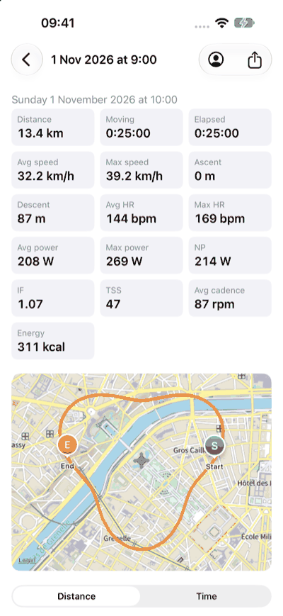
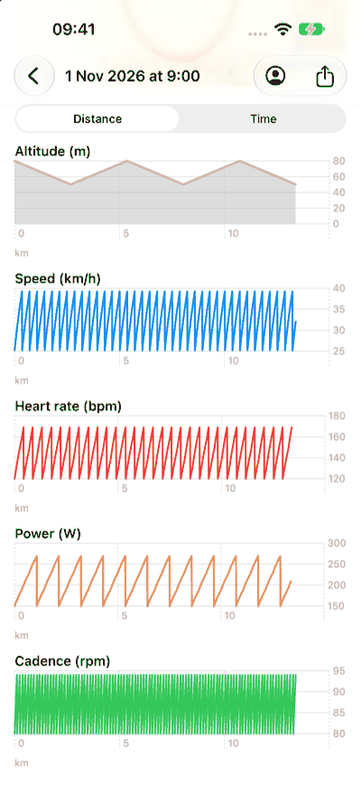
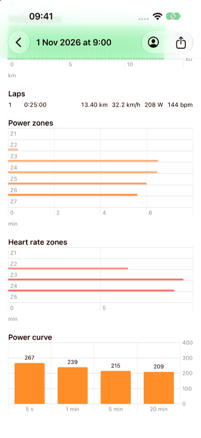
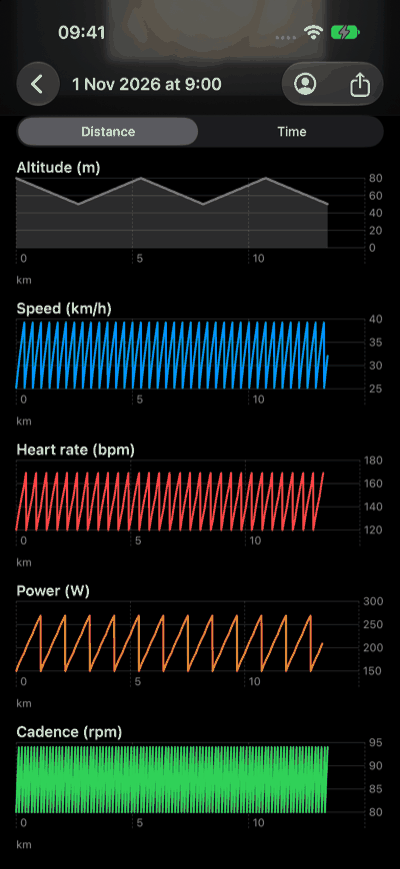
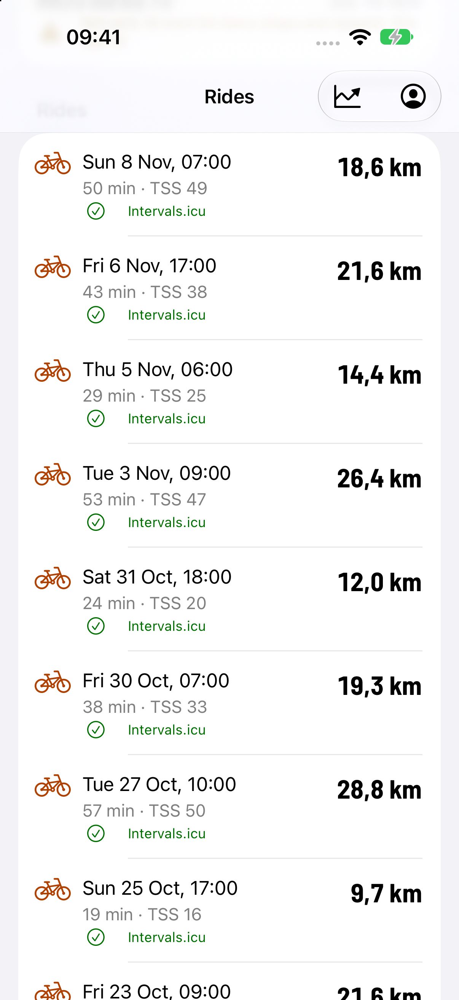
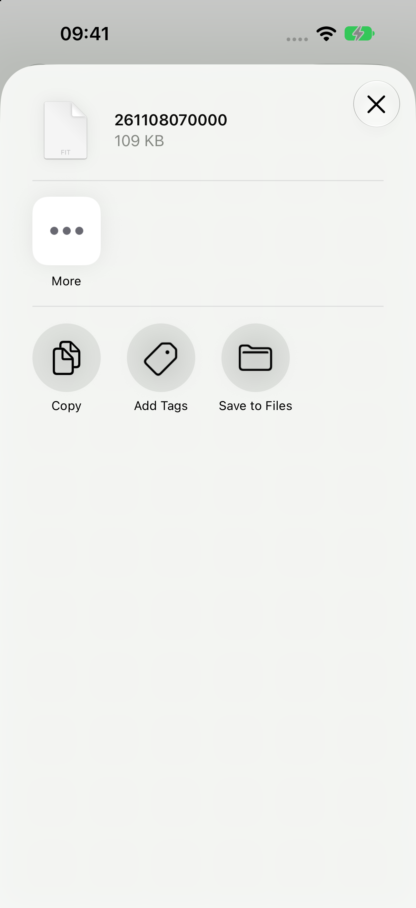

# The phone app

Walking skeleton (roadmap section 9, A2 and A3 started): an iPhone app that finds the bike computer, reads its
Battery Level (0x2A19) and Manufacturer Name (0x2A29) and shows them. The bytes are decoded by a Rust core
(`app/core`, UniFFI), so the app and the unit share code; Swift only moves bytes from CoreBluetooth. The firmware
is unchanged: it already serves Battery 0x180F and Device Information 0x180A openly (HID is hidden from apps by iOS).

The unit advertises only while pairing, or bonded and not connected. When the phone already holds the link (the
notifications bond), the app asks the system for it with `retrieveConnectedPeripherals(withServices:)`, and scans
otherwise. It looks for the name "S510". Confirmed on the owner's iPhone (2026-11-07): the app shows S510, rustfw and
the battery, through `retrieveConnectedPeripherals`. The scan's filter on 0x180F is inferred: whether the unit's
advertisement carries 0x180F is not verified.

## Build

Needs Xcode 16 or later, Rust (the pinned toolchain, with `aarch64-apple-ios` and `aarch64-apple-ios-sim`).

    app/ios/build-core.sh          # core for both iOS targets, Swift bindings, XCFramework (app/ios/Generated)
    cd app/core && cargo test      # the core's tests, on the Mac
    xcodebuild -project app/ios/Bryton.xcodeproj -scheme Bryton -sdk iphonesimulator \
        -destination 'generic/platform=iOS Simulator' CODE_SIGNING_ALLOWED=NO build

The simulator has no Bluetooth: the app shows "This device has no Bluetooth". check.sh runs the core's clippy and
tests, and the simulator build when something under `app/` changed on a branch.

## Install on an iPhone with a free Apple ID

1. Xcode > Settings > Accounts: add your Apple ID (a personal team appears).
2. `cp app/ios/Local.xcconfig.example app/ios/Local.xcconfig`; set `DEVELOPMENT_TEAM` (your team id) and a
   `BUNDLE_ID_PREFIX` of your own. The file is gitignored.
3. On the phone: Settings > Privacy & Security > Developer Mode on (restart).
4. Run `app/ios/build-core.sh`, open `app/ios/Bryton.xcodeproj`, pick the phone, Run. On first launch trust the
   developer under Settings > General > VPN & Device Management.

The install lasts 7 days; Run again renews it. After one cable pairing, Xcode's "Connect via network" lets Run work
over Wi-Fi.

### First install, the traps

- Developer Mode appears in Settings > Privacy & Security only after Xcode has connected to the phone once.
- Xcode cannot mount its developer disk image while the phone is locked: keep it unlocked on the home screen.
- The first launch needs Settings > General > VPN & Device Management > Developer App > Trust.
- Installing from the terminal works (`<UDID>` from `xcrun devicectl list devices`):

      app/ios/build-core.sh
      xcodebuild -project Bryton.xcodeproj -scheme Bryton -destination 'id=<UDID>' -allowProvisioningUpdates build
      xcrun devicectl device install app --device <UDID> <path of Bryton.app in DerivedData>
      xcrun devicectl device process launch --device <UDID> <bundle id>

## The icon

Ferris the crab (the unofficial Rust mascot) riding a bike on a teal background: few shapes, bold outline, one
background, so it reads at 60 px. The dark variant swaps the teal gradient for a deep teal one, and the tinted variant
is its greyscale. Ferris is the artwork from https://rustacean.net, released to the public domain
(CC0 1.0, https://creativecommons.org/publicdomain/zero/1.0/; the site's footer says so), kept as
`app/ios/Icon/ferris-rustacean.svg`. The bike is drawn here and carries no brand mark. Edit `app/ios/Icon/icon.svg`,
run `python3 app/ios/Icon/render.py`: it writes the light, dark and tinted 1024 px PNGs (opaque, iOS rounds them)
into the asset catalog.

## Distribution

Build from source for now. TestFlight and the App Store need the paid Apple Developer account, and the App Store's
terms are to be checked against this project's GPLv3. The free route for others is an Android APK (step A4).

## Rides

The ride list and download (roadmap 9, A1 reads). `app/core/src/files.rs` is a sans-IO `FileClient`: Swift writes the
bytes it returns to Control (write with response) and feeds every Data notification to `onData`. Frames are encoded and
decoded by the firmware's own `src/link/filesvc.rs`; no chunk size is assumed (each CHUNK gives its length), so the
faster link needs no app change. The file is kept in memory; after BUSY, a link drop or 5 s of silence `resumeCommand`
asks READ again from the bytes kept. The final length is checked against LIST's size and END's count against the bytes
of the answer: a short file is an error, never a silent truncation.

The screen lists the rides (date and time from the `YYMMDDhhmmss` name, size in KB, a check mark when already saved),
pull to refresh; a tap downloads with a progress bar and KB/s, saves `<name>.fit` in the app's Documents (visible in
the Files app: `UIFileSharingEnabled`, `LSSupportsOpeningDocumentsInPlace`) and opens the ride viewer (below); a tap on a ride already saved opens it at once, and the viewer's share button opens the share sheet. A small line
shows `maximumWriteValueLength`, to read the negotiated MTU off the screen for the fast-link test.

**Demo** (the Simulator has no Bluetooth): the "Demo" button runs the same core against the Rust fake unit serving three
synthetic rides made by the firmware's FIT writer (an invented loop around the Eiffel Tower, a public landmark, no real data). Launch arguments `-demo` and
`-demo-dl` start it by themselves (`xcrun simctl launch booted <bundle id> -demo -demo-dl`, then
`xcrun simctl io booted screenshot`).

## The ride viewer

Roadmap 9, "Ride insights" (the owner's order of 2026-11-07: download speed first, then parity with Bryton's app).
`app/core/src/ride.rs` `analyze_ride(bytes, ftp, max_hr)` gives the viewer a `RideView`: the summary (times, distance,
ascent and descent, speeds, HR, power, cadence, NP, IF, TSS, kcal, laps, time in 5 HR and 7 power zones, best power
over 5 s, 1, 5, 20 and 60 min) and at most 2000 samples (time, position, altitude, speed, HR, power, cadence; per
bucket the first sample and the highest-power one, so the graphs keep their peaks). NP, IF, TSS, kcal, the zones and
the curve are the firmware's own code (`power`, `power_curve`, `ride`), so the app and the unit agree. The FIT is read
with the `fitparser` crate (MIT), not the firmware's streaming `fitread`, which gives only the fields the unit shows
(no speed, cadence, calories, descent, lap start); a panic inside the crate is caught and reported as an unreadable
file, and the tests cut and corrupt a ride at hundreds of points.

The screen (`RideDetail.swift`, `RideMap.swift`): a grid of the metrics, the map, five Swift Charts graphs (altitude,
speed, HR, power, cadence) against distance or time, the laps, the zone bars and the power curve. Dragging on a graph
puts a marker on the map. The map is an `MKMapView`: inside France the base is IGN's Plan IGN v2 (WMTS
`https://data.geopf.fr/wmts`, layer `GEOGRAPHICALGRIDSYSTEMS.PLANIGNV2`, matrix set `PM`, no key; checked 2026-11-07),
elsewhere Apple's map. The person icon opens FTP and max HR (UserDefaults, default 200 W and 190 bpm) until the unit's
profile can be read. Launch argument `-demo-scroll graphs|laps` scrolls the viewer for screenshots.

| | | | |
|:-:|:-:|:-:|:-:|
|  |  |  |  |
| Summary and track on IGN | Graphs | Laps, zones, curve | Dark mode |

Screenshots from the Simulator (an iPhone 18 Pro, demo mode; the Xcode here had no iPhone 16 Pro simulator):

| | | |
|:-:|:-:|:-:|
|  |  |  |
| The ride list, demo mode | A download: bytes of the file, KB/s, cancel | The downloaded ride, share sheet (Save to Files) |

Not yet tried on a phone: that the service is found after `retrieveConnectedPeripherals` (the app discovers `aa3c0001`
itself), that the first Data subscription makes iOS encrypt with the stored bond, the speed over the real link.

## Seen on the unit, 2026-11-07

On the owner's iPhone 16 Pro (iOS 27):
- The app shows S510, rustfw and the battery.
- The unit's PHONE menu shows the FAST LINK row: the radio chip took the MTU 247 configuration.
- iOS negotiated ATT MTU 247: `maximumWriteValueLength` is 244 without response and 512 with.
- A 468,042-byte ride downloaded whole, byte-identical to the same file read over USB (`dev.py drive`, then `cmp`).
- Speed is about 3 KB/s, far below the simulator's 34 KB/s. Under investigation (connection event length); a separate branch.
