# Gallery

Every screen of the firmware, grouped by where it is on the bike computer. "sim": drawn by the firmware's own code in the host simulator; "unit": a screenshot over USB.

## Overview

| | | |
|:-:|:-:|:-:|
| 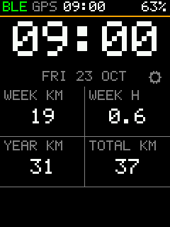 | 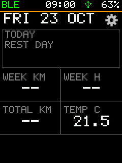 | 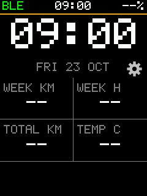 |
| Overview: the date, today's planned workout with its profile, four fields, notices (sim) | The overview's TODAY card with nothing planned (sim) | The overview's cog opens the menu (sim) |
| 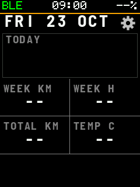 | 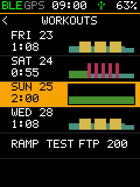 | 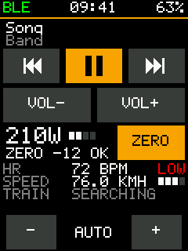 |
| The same with FONT = SMOOTH (Barlow Semi Condensed Bold) (sim) | WORKOUTS: each day's profile beside its date and length; a rest day's card gets here, else it opens today's workout (sim) | The quick panel, a swipe down anywhere: the media remote, each sensor with its battery (LOW in red), the POWER line with its ZERO button (tap twice) and the brightness; a long title scrolls (sim) |
| 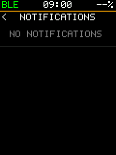 | 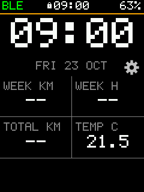 |  |
| An empty list says so in a row: no notifications (sim) | The touch lock: a padlock in the strip (sim) |  |

## Ride pages and fields

| | | |
|:-:|:-:|:-:|
| 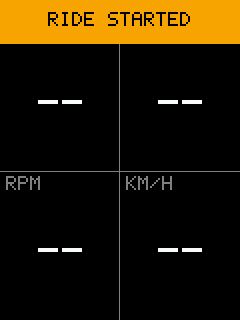 | 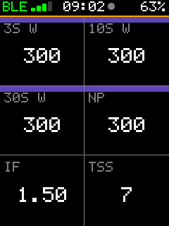 | 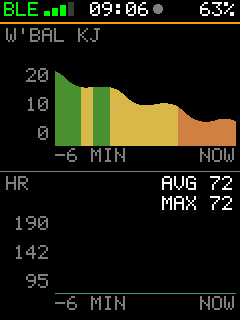 |
| Start: the ride, said in a banner at the top (sim) | Power: 3 / 10 / 30 s, NP, IF, TSS (sim) | Graph of W' balance; a tap goes to the next plot, never while recording (sim) |
| 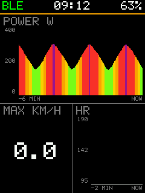 | 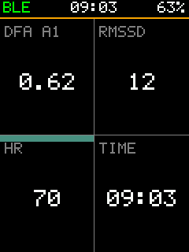 | 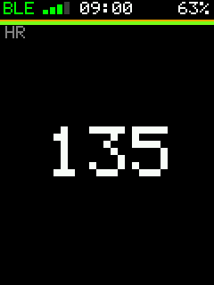 |
| Power graph with its axes, over the HR graph (sim) | DFA a1 and RMSSD from the strap's beats (sim) | A zone as an 8 px bar on the box's top edge (sim) |
| 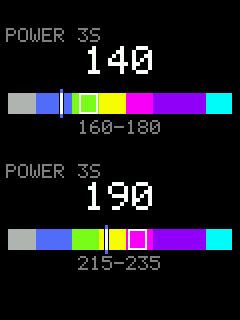 | 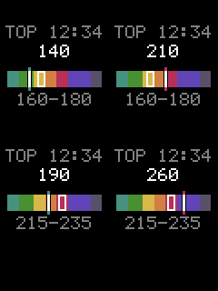 | 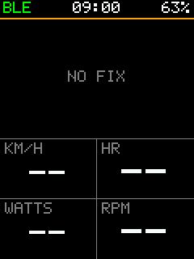 |
| The target gauge spans every zone, power from 40 to 165 % of the FTP (sim) | The same in a half box: the climb pacer's TOP field (sim) | An uneven layout: a big box over 2 x 2 (sim) |
| 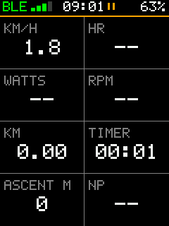 |  |  |
| Eight fields, four rows of two (sim) |  |  |
| 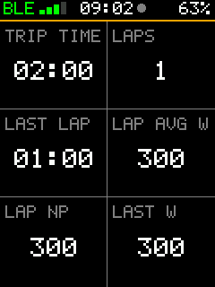 |  |  |
| Trip time, laps, last lap, lap power and lap NP on a ride page (sim) |  |  |
| 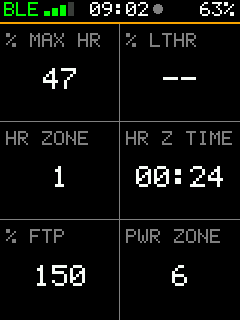 |  |  |
| % of max HR (LTHR not set: "--"), heart-rate zone and its time, % of FTP and the power zone on a ride page (sim) |  |  |
| 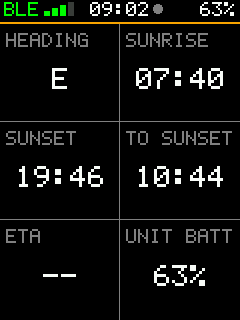 |  |  |
| Heading, sunrise, sunset, time to sunset, ETA ("--" off course) and the unit's battery on a ride page (sim) |  |  |

| 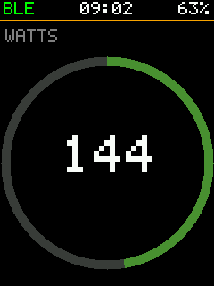 | 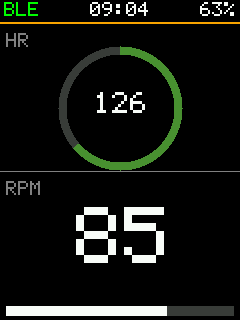 | 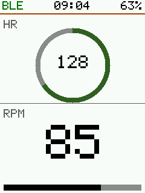 |
| POWER RING on a 1-field page: the digits sized to the ring's hole, the arc in the zone's colour (sim) | HR RING over CAD BAR (sim) | The same in the LIGHT theme (sim) |

## Page editor

| | | |
|:-:|:-:|:-:|
| 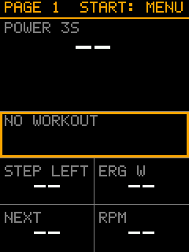 | 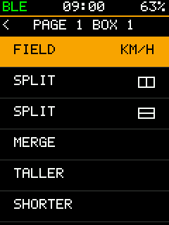 | 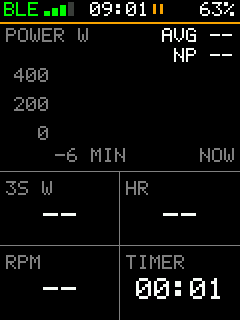 |
| The page editor: a box held, framed in orange, live values, the hint in the strip's place (sim) | Start in the editor: the box's actions, SPLIT across or down by their icons (sim) | A page made in the editor: a graph over four values (sim) |
| 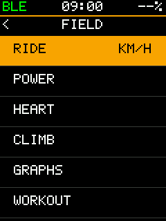 |  |  |
| A page's field: its group, then the field (sim) |  |  |

## Map

| | | |
|:-:|:-:|:-:|
| 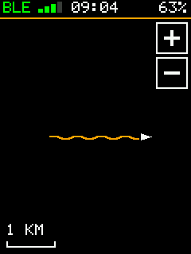 | 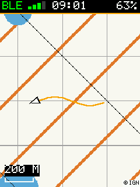 | 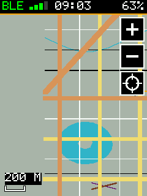 |
| Map with the track (sim) | The map over IGN pack tiles, "(c) IGN" in the corner (sim, synthetic tiles, not a map) | The map zoomed in with "+" and "-", panned by a drag, the crosshair to follow again (sim, synthetic tiles) |

| 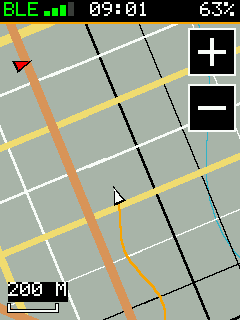 | | |
| HEADING UP (DISPLAY > MAP): riding west, the map turns so the top is the course; the red arrow is north (sim, synthetic tiles) | | |

## Courses and climbs

| | | |
|:-:|:-:|:-:|
| 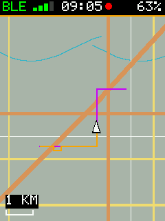 | 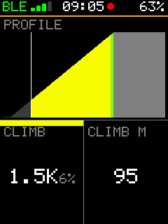 | 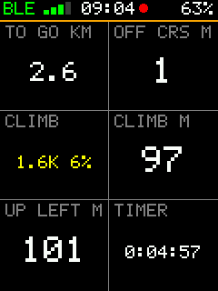 |
| A course followed: the line under the track (sim) | The course profile: climbs by grade, the rider's place (sim) | Distance to go, off course, the climb ahead, the climb pacer's TOP field (sim) |
| 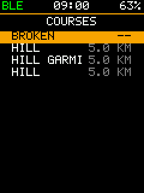 | 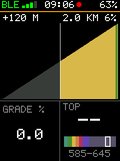 | 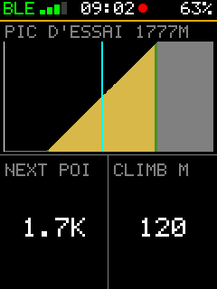 |
| Courses on the card: stock's routes, FIT, GPX (sim) | The CLIMB page, opened when the climb starts: the climb's title (length, grade) and the gain left in metres, its profile by grade with the part done dark and the rider white, the climb coach's gauge, the elapsed time and the distance left (sim, made-up road) | The profile names the next peak or col (title: name and elevation) and marks each one with a cyan column; NEXT POI is the distance to it (sim, made-up names on synthetic tiles) |

| 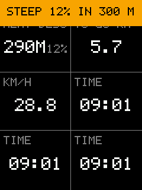 | | |
| STEEP DESCENT 10 %: the banner 300 m before a 12 % drop, and the DESCENT AHEAD field counting down (sim, made-up course) | | |

## Workouts and training

| | | |
|:-:|:-:|:-:|
| 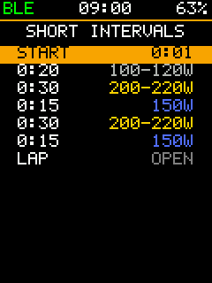 | 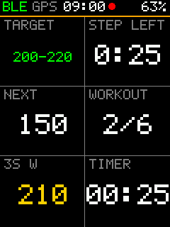 | 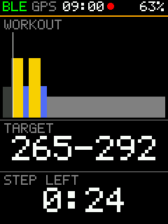 |
| A planned workout's steps, from stock's calendar (sim) | A workout running: target, step left, next (sim) | The workout graph: steps by target and zone, the rider's place (sim) |
| 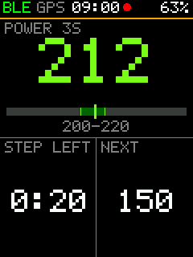 | 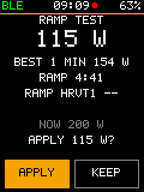 |  |
| The workout gauge: 3 s power on the step's band (sim) | FTP ramp test result: FTP, best minute, APPLY / KEEP (sim) |  |

## End of a ride and history

| | | |
|:-:|:-:|:-:|
| 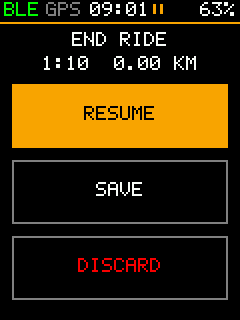 | 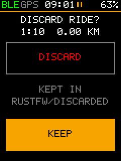 | 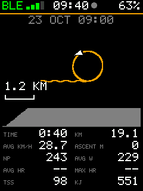 |
| Start held while paused: RESUME, SAVE (selected), DISCARD, big enough for gloves (sim) | DISCARD asks once more; the ride is moved to `\Rustfw\Discarded`, never erased (sim) | The ride's card when it ends: map, profile, numbers (sim) |
| 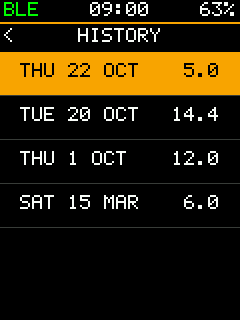 | 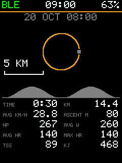 | 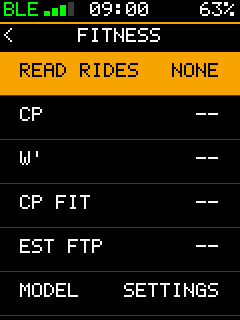 |
| History: stock's rides, newest first (sim) | A past ride's card, read from its file; DELETE in red asks first (sim) | HISTORY > FITNESS: CP, W', EST FTP, HRVT1 / HRVT2 from past rides (sim, no rides read) |
|  |  |  |
| HISTORY > FITNESS > POWER CURVE: the 90 days' bests (orange) and this ride's (green) on a log axis from 1 s to 1 h, CP and W', the cursor reading 5 MIN (sim) | The same in LIGHT (sim) |  |
|  |  |  |
| HISTORY > FITNESS > TRAINING LOAD: 90 days of CTL (orange), ATL (yellow) and TSB (bars), the cursor reading a day (sim, synthetic rides) | The same in LIGHT (sim) | FITNESS > MONTHS: a row per month, Select changes km, hours, rides, ascent, TSS (sim) |
|  |  |  |
| A past ride's LAPS: number, time, distance, speed, power and heart rate per lap, from its `lap` messages (sim; the sim's ride has no speed or sensors) | A ride with no lap messages (sim) |  |

## Menus and settings

| | | |
|:-:|:-:|:-:|
|  |  |  |
| The menu: what to ride, what was ridden, then the set-up; 44 px rows, a tap acts on a row (sim) | Page held during a ride: the ride menu, only what a rider does on the road (sim) | SETTINGS > ME: values with their units, edited in place (sim) |
|  |  |  |
| SETTINGS: a menu per subject, any setting three levels down at most (sim) | SETTINGS > BIKE: wheel, weight, altitude, profile, climbs ahead (sim) | SETTINGS > ME: MAX HR, LTHR, ZONES BY, ZONES, FTP, then sex, birth year and height (sim) |
|  |  |  |
| ME > ZONES: the top of each heart-rate and power zone, edited one by one (an edited bound is kept; RESET at the end) (sim) | SETTINGS > BIKE > PROFILE on COMMUTE, after AUTO, ROAD, INDOOR, MTB, GRAVEL and CX (sim) |  |
| | | |
|:-:|:-:|:-:|
|  |  |  |
| ABOUT under SYSTEM: the version and the commit, Ferris, the map and font notices (sim) | STORAGE under SYSTEM: the card's size, free space, rides and the five oldest, read over the passes (sim) | The oldest ride's card from STORAGE, DELETE on it as in HISTORY (sim) |

## Sensors and phone

| | | |
|:-:|:-:|:-:|
|  |  |  |
| Sensors and built-in readings (sim) | Speed page (sim) | SENSORS > CALIBRATE POWER: zero offset and auto zero (sim meter) |
|  |  |  |
| SENSORS with the strap's maker from ANT+ common page 80 (POLAR HR, device number 9: synthetic) (sim) | The phone's media remote: what plays (AMS), the keys (sim) | An incoming call from the phone (ANCS): the banner at the top, the buttons name their keys (sim) |
| The phone's media remote: what plays (AMS), the keys (sim) | An incoming call from the phone (ANCS): the banner at the top, the buttons name their keys (sim) |  |

## Alerts

| | |
|:-:|:-:|
|  |  |
| A power high limit crossed for 5 s: the red banner and three beeps (sim) | SETTINGS > ALERTS, scrolled to its end: limits and reminders, each OFF until set (sim) |

## Power match

| | |
|:-:|:-:|
|  | |
| ERG with a power meter reading 20 W under the trainer: "PM+10%" left of the source line (sim) | |

## Themes

| | | |
|:-:|:-:|:-:|
|  |  |  |
| DARK: the colours as they were (sim) | OUTDOOR: lighter notes and lines, brighter zones (sim) | OUTDOOR on a ride page (sim) |
|  |  |  |
| SETTINGS > DISPLAY > THEME cycles DARK, OUTDOOR, LIGHT and the files of `\Rustfw\Themes` (sim) | A theme file from the card: SUNNY, OUTDOOR with a blue accent (sim) | LIGHT: black on white for the sun (sim) |
|  |  |  |
| LIGHT on a ride page (sim) | LIGHT menu (sim) | LIGHT map page: the basemap stays a picture (sim) |
|  |  |  |
| `menu_row = 44` (the built-ins): six rows (sim) | `menu_row = 56`: four rows, a tap lands on the row drawn (sim) | `zone_bar = 4`, the thinnest, on the heart rate box (sim) |
|  |  | |
| `overview = fields`: a 2 x 2 table (time, next workout, year km, week hours) in the card's place (sim) | The same with the metrics at their least (sim) | |

## Laps

| | |
|:-:|:-:|
|  | |
| AUTO LAP BY DISTANCE 5 km: the banner of lap 1 with its number, time, distance and average speed (sim) | |

## Live segments

| | | |
|:-:|:-:|:-:|
|  |  |  |
| The CLIMB page on a segment ahead of the PR: the delta in green, the segment's profile with the rider (white) and the PR's ghost (grey), the pacer's gauge with its target, the elapsed time and the distance left (sim) | Behind: the accent, never red (sim) | The result card, a new PR (sim) |
|  | | |
| MENU > SEGMENTS: the two settings, the segments of the card, the skipped files (sim) | | |

## Units

| | |
|:-:|:-:|
|  | |
| UNITS IMPERIAL and TEMPERATURE F on a ride page: mph, miles, feet, F and a trip in miles, with their labels (sim) | |
## Workouts

| | |
|:-:|:-:|
|  |  |
| The next-step strip in the status strip's place, 6 s before the step ends (sim) | A step with two targets: "200-250/90-100RPM" under the bar (sim) |

## Page switches

| | |
|:-:|:-:|
|  |  |
| PAGES > ROAD PAGES > a page: SHOW, MOVE UP, MOVE DOWN and RENAME under its fields (sim) | A page renamed "CA B" in the list (four characters at most; sim) |

## Quick Status

| | |
|:-:|:-:|
|  | |
| A tap on a plain field of a ride page: the six chosen fields in a 2 x 3 grid, closed by Back, a tap or 10 s (sim) | |

## Start reminder and ready check

| | |
|:-:|:-:|
|  |  |
| START THE RIDE? after 10 s of pedalling with no ride (sim) | The ready card over a new ride: GPS, battery 12 %, a power meter not heard (sim) |

## Climbs done

| |
|:-:|
|  |
| CLIMBS DONE in the ride menu: length, average grade, time and VAM of the hill ridden to its top (sim) |

## Course: reversed, and the way to its start

| | |
|:-:|:-:|
|  |  |
| The synthetic hill followed backwards (COURSE > REVERSE COURSE): the profile runs downhill, the first turn is a right (sim) | Off the start: NEXT TURN shows the way to it, a compass point and the distance (N390M), until the course is joined (sim) |
